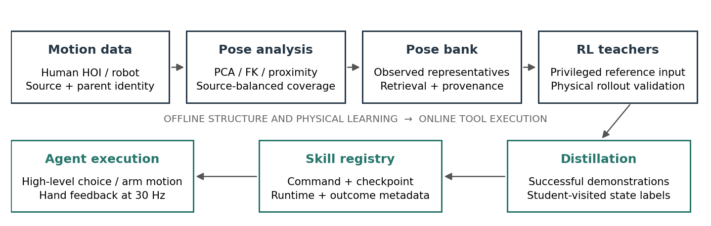
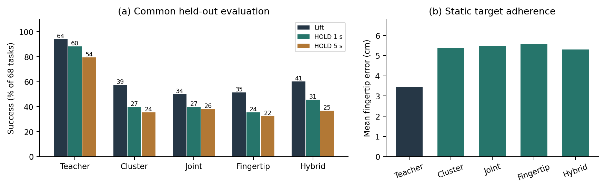
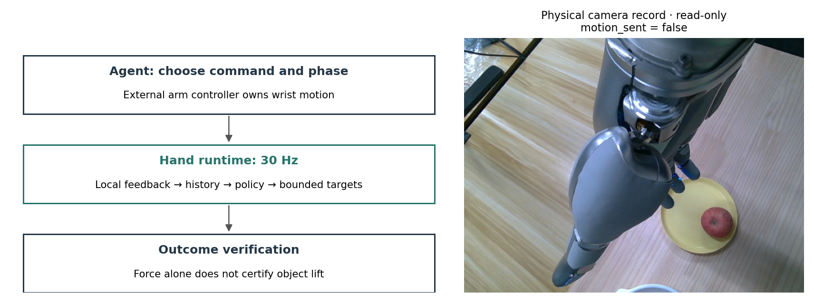

# RLDexAgents: An Extensible Dexterous Skill Toolkit for LLM Agents

*From Hand Pose Manifolds to Interface-Conditioned Skill Distillation and Agentic Manipulation*

Technical report · Evidence audited 27 October 2026 · Sharpa right-hand implementation

## Executive Summary

Dexterous manipulation requires continuous coordination of many joints, object-dependent contacts and feedback-driven corrections. An LLM agent can select an intention or a grasp candidate, but neither a language instruction nor a plausible static hand pose determines the control needed to establish and maintain a grasp. RLDexAgents investigates an intermediate layer: heterogeneous human and robot motion is organized into pose representations, evaluated through reinforcement-learning (RL) teachers, distilled into command-conditioned hand controllers, and exposed through a skill registry and execution runtime.

The implemented pipeline includes large-scale pose analysis, a six-cluster hand–object proximity representation, pose and demonstration retrieval, reference-tracking teachers, recurrent students, simulator evaluation, and an agent-facing hand-control toolkit. The agent chooses commands and the external controller moves the wrist; an eight-frame student controls 22 finger joints at 30 Hz. Object state and future references available to the teacher are absent from the student's deployment feedback. This report addresses three questions: how motion is structured across sources and embodiments (RQ1), how that structure can guide executable skill distillation (RQ2), and how the resulting controllers can become reusable agent tools (RQ3).

Five findings summarize the current evidence. First, among 1,029,112 indexed Sharpa poses, 1,015,044 satisfy URDF joint limits. A 24-entry joint-space representative bank obtains 0.2263 rad source-macro median coverage error versus 0.2597 rad for random selection, a 12.9% reduction in this metric. Second, 14 PCA components retain 96.1% of variance in the source-balanced fitting experiment but still incur 10.1 mm mean fingertip reconstruction error after joint-limit clipping. Variance retention is therefore not an execution tolerance. Third, manifold-guided demonstration selection does not improve the expanded grasp test: 343/2,365 successes versus 354/2,365 for quota-matched random selection, with a paired-parent difference interval spanning zero. Fourth, on 68 parent-held-out student tasks, the common teacher achieves 64 grasps and 54 five-second HOLD successes; the four students achieve 34–41 grasps and 22–26 five-second HOLD successes. Fifth, a 28-task command ablation finds that both fixed random groups and pose-cluster commands improve some outcomes over no command, but does not establish that geometric clusters are superior to random grouping.

These results support structured pose retrieval and a working closed-loop toolkit, not universal grasping or autonomous skill acquisition. Major limitations are successful-demonstration selection bias, mismatched teacher and student information, phase semantics that vary across checkpoint families, incomplete contact characterization, and limited independent training seeds. Physical runtime integration and qualitative user feedback exist, but countable real-robot grasp trials are not available in the audited record. Next experiments should prioritize command-sensitive contact establishment, matched training seeds, independent command generation, and separately verified physical outcomes. Raw supporting results are included locally.

## 1. Introduction

A dexterous hand exposes a difficult interface to a language-based agent. Even when an agent identifies the correct object and intended action, it must resolve an end-effector approach, a compatible hand configuration, contact establishment, load transfer and subsequent stabilization. A full joint trajectory is cumbersome to specify and fragile to geometric error. A static grasp library is easier to retrieve, but does not encode how the hand reacts when contact differs from expectation. A task-specific RL policy can supply feedback, yet usually binds the controller to a narrow objective or scene.

We investigate a middle representation between these alternatives. A **pose bank** stores representative configurations and their provenance. A **skill bank** associates commands with controllers, execution conditions and measured outcomes. A **registered tool** makes those controllers available to a higher-level agent with a defined input and feedback interface. These are distinct objects: geometric proximity in a pose bank does not establish contact equivalence, and a skill label does not certify a successful rollout.

Hand-synergy research motivates analyzing structured variation in posture [@santello1998]. It does not imply that low-dimensional posture alone determines contact forces or manipulation outcomes. DAgger addresses the mismatch between demonstration states and states visited by a learned policy through online expert labeling [@ross2011]. Asymmetric actor–critic methods motivate using training information unavailable to the deployed actor [@pinto2018]. Language-grounded skill selection motivates separating high-level choice from low-level feasibility [@ichter2023]. RLDexAgents applies these ideas to an existing Isaac Lab, Sharpa and PPO codebase rather than introducing a separate simulator or learning framework.

The research questions are:

- **RQ1:** How are hand poses structured across datasets and embodiments, and how effectively do representative banks cover them?
- **RQ2:** How can structured representations guide command-conditioned distillation, and where does successful teacher execution fail to transfer?
- **RQ3:** Which runtime interfaces make these controllers usable by agents, and which claimed capabilities remain unverified?

The contribution is an integrated research implementation and a traceable set of positive and negative findings. We provide source-balanced geometric analysis, contact-proximity clustering with interactive examples, reference-conditioned teacher training, several student recipes, a matched four-interface comparison, and a local skill runtime. We do not present all historical checkpoints as a controlled architecture study, nor claim that a hand-only student solves end-to-end object localization and wrist planning.

## 2. System Overview

The pipeline separates seven responsibilities. Data adapters preserve human or robot motion, object references and source identity. Pose analysis measures statistical structure and geometric coverage. A pose bank retrieves observed configurations. RL teachers convert reference trajectories into physically executed trajectories. Distillation compresses teacher behavior into a limited command interface. A registry associates checkpoints with command semantics and supported conditions. Finally, an execution runtime turns a command and current hand feedback into joint targets while reporting status.



The wrist and hand have separate responsibilities. In the reported simulator distillation experiments, the wrist follows an external reference; in agent-facing use, an external arm controller must produce a feasible approach and subsequent motion. The student does not output arm actions. At each 30 Hz hand tick it receives local feedback and the active command, then emits 22 normalized finger actions. The runtime decodes those actions into bounded physical joint targets. A rendered hand near an object is therefore not evidence that the complete agent–arm–hand system can autonomously acquire that object.

Evidence is organized by protocol, not date. E01–E03 concern representations, E04 teacher continuation, E05–E08 student execution, E09 runtime integration E10 demonstration selection and E11 student-only RL. “Held out” refers to a specified training stage; “success” always has a temporal and physical criterion. The report's interactive supplement preserves all 6,241 HOI points, representative gestures and localized videos, while the main figures emphasize the mechanisms and comparisons needed to interpret the results.

## 3. Large-Scale Hand Motion Data and Pose Manifold Analysis

### 3.1 Data units, sources and coverage

The training reference pool and the larger analysis collection are different datasets. A reference may be a segment of a parent capture; a sampled posture is a frame; a parallel environment slot is neither. Table 1 describes the established HOI pool used before the three-record RoboTool extension. The latest audited object-goal teacher uses 6,244 records in 8,192 environment slots. It does not use freehand data in that continuation.

| Training source | HOI reference records | Interpretation |
|---|---:|---|
| SPIDER-derived adapters | 1,386 | Multiple original datasets; retargeted references |
| Corrected human-wrist collection | 68 | Prepared right-hand HOI records |
| OakInk native | 600 | Selected prepared training stages |
| DexCanvas | 3,435 | Training windows, not unique raw recordings |
| DexterHand | 752 | Training windows from source sessions |
| **Established pool** | **6,241** | **3,185 unique parents in the clustering index** |
| RoboTool addition | 3 | Added in the 6,244-record teacher continuation |

*Table 1. Reference-pool accounting (E02/E04). Dataset counts are not episode counts across all raw collections.*

The full pose analysis indexes 1,029,112 Sharpa configurations from 13 adapter/source groups. DexCanvas dominates this collection: the expanded retarget collection contains 111,857 raw trajectories. Separately, an earlier 21,918-trajectory snapshot produced 61,822 windows, with 49,431 training windows, of which 3,435 entered the established teacher pool. Subtracting windows from raw trajectories would give a meaningless “unused” count. SharpaDex contributes 12,771 freehand segments and 10,113,608 frames in its inventory; these provide unconstrained hand motion rather than object-interaction supervision. Earlier mixed training used freehand sampling, whereas E04 is HOI-only.

The data inventory also records expanded OakInk and HRDexDB retargeting beyond the established teacher set. OakInk has 627 source annotations and 2,840 stages; 711 earlier and 1,164 expanded successful retarget results are recorded, while 600 native stages enter the established teacher pool. HRDexDB has 441 human episodes, 246 SPIDER-derived short references and 194 newly prepared full trajectories. Availability, successful conversion and training inclusion are separate statuses. The report includes the inventory snapshot, rather than implying that every available retarget result was trained.

### 3.2 Coordinates, normalization and retargeting

Sharpa pose analysis uses the ordered 22 right-hand joint angles. Human analysis uses normalized 60D landmark coordinates, with wrist removed and the remaining 20 landmarks expressed in a hand-local convention. Joint-space and landmark-space PCA have different units, constraints and weighting. Comparisons across these spaces are descriptive; their dimensions are not an absolute measure of dexterity.

For a world-space fingertip position and palm transform, palm-local coordinates are:

$$p^{tip,palm}=R_{palm}^{T}(p^{tip,world}-p^{palm,world}).$$

Object-local contact coordinates use the analogous object transform. This makes coordinates consistent within an asset and trajectory, but does not automatically align the semantic axes of unrelated objects. A jug's native mesh frame need not have the same meaning as a tool's frame. Neither object-local pose overlap nor a common embedding establishes matched affordances across assets.

Retargeting fits robot joints to human or robot landmark targets under the robot's kinematics. Its output must still be checked against limits, mesh intersections and dynamic execution. For PCA, 14,068 indexed robot poses violate at least one URDF limit and are excluded. Some SPIDER source subsets have especially low valid fractions; the audit does not establish whether convention, retargeting or source processing is the cause. Such anomalies remain data-quality questions rather than grounds for silently changing joint order.

### 3.3 PCA, reconstruction and representative banks

For centered pose vectors, PCA projects onto the leading covariance eigenvectors and reconstructs in the original feature space:

$$z=U_k^T(q-\mu),\qquad \hat q=\mu+U_kz.$$

E01 partitions by trajectory key, caps fitting and test contributions by source, and obtains 8,867 fitting and 5,016 test samples. Representative-bank coverage is the nearest-entry joint RMS error, aggregated as the mean of source-wise medians. This prevents the largest source from alone determining the reported coverage:

$$d(q,B)=\min_{b\in B}\sqrt{\frac{1}{22}\sum_{j=1}^{22}(q_j-b_j)^2}.$$

The compared methods are random selection, joint KMeans, PCA+KMeans, approximate PCA+K-Medoids and a handcrafted posture taxonomy. All exported entries are actual limit-valid observations. KMeans centers are replaced by nearest observed configurations; they are not directly executed as synthetic mean poses. Medoids optimize representative selection within a finite candidate pool. Their factual advantage is observed-pose membership, not demonstrated superior coverage.

| Components | Variance retained | Joint RMS, rad | Fingertip mean / P95, mm | Poses outside limits before clipping |
|---:|---:|---:|---:|---:|
| 4 | 69.1% | 0.1958 | 19.38 / 47.34 | 44.0% |
| 6 | 78.5% | 0.1599 | 18.06 / 45.17 | 57.6% |
| 8 | 85.4% | 0.1313 | 15.09 / 36.78 | 60.0% |
| 10 | 90.2% | 0.1070 | 12.48 / 31.22 | 70.0% |
| 14 | 96.1% | 0.0717 | 10.11 / 26.74 | 76.0% |
| 22 | 100% | ≈0 | ≈0 / ≈0 | 0% |

*Table 2. E01 reconstruction. FK is evaluated after clipping; the limit-violation fraction is measured before clipping. Small boundary crossings count as violations, so the fraction need not decrease monotonically with component count.*


The filtered Sharpa all/HOI/freehand cohorts require 13/14/9 components for 95% variance; the normalized human landmark cohort requires 10. Earlier unfiltered analyses reported different values. Neither comparison estimates an invariant intrinsic manifold dimension. Complete variance curves, reconstruction errors and bank-size trends are more informative than a single threshold.

### 3.4 Contact-aware geometry and cross-embodiment analysis

E02 compares five representations on 6,241 selected interaction configurations: joints alone, legacy hand–object relations, fingertip relations, link-near features, and link-near plus distance. The latter contains joint, palm/object and shape terms together with proximity and normalized clearance for 26 hand links. Feature blocks are scaled to prevent a high-dimensional block from dominating by construction; parent weighting reduces repeated-capture dominance. Near-contact geometry is computed from collision meshes, not from force readings.

The final six groups contain 2,278 / 1,560 / 624 / 644 / 374 / 761 records. Link-near-and-distance has silhouette approximately 0.087 and restart ARI approximately 0.997. Joint-only silhouette is higher, approximately 0.136. These metrics measure different properties: reproducible partitioning need not imply strong cluster separation or physical semantics. We call them C0–C5 identifiers within this representation, not natural functional grasp categories. The interactive projection supports coloring by dataset, source lineage or cluster and locating representative gestures; a 3D projection can distort distances and must be read alongside the full-space metrics.

Wuji Hand 2 provides an independent cross-embodiment probe (E03): 175 episodes, 95,890 frames, and 1,400 sampled poses. Twenty right-hand joints are mapped through Wuji FK to landmarks and fitted to Sharpa's 22 joints. Mean fingertip fit error is 4.13 mm. This is an independent-pose kinematic fit, not a temporal, contact or manipulation validation. Anatomical channel ordering also requires further source-video confirmation. Projection into a historical Sharpa pose partition populates only some groups; those labels are not interchangeable with the final HOI link-near classes. Human, Wuji and Sharpa results therefore establish measurable representation relationships without establishing transferable contact behavior.

## 4. From Pose Manifold to Skill Bank

A pose cluster groups nearby representations. A representative pose, often supplied as `q_seed`, is a concrete configuration or conditioning target. A successful contact configuration is an observed hand–object state with a verified physical outcome. An executable skill is a feedback policy plus its input, initialization and runtime semantics. A registered agent tool adds callable operations and status reporting. Moving from one level to the next requires evidence not supplied by clustering alone.

Our pose bank retrieves actual configurations, source identifiers and examples. A skill record should additionally identify the checkpoint, command representation, compatible joint ordering, supported external wrist motion, initialization conditions, evaluated object set, measured success criterion and known failures. Existing toolkit metadata and model-specific loaders cover parts of this interface. Uniform registration of arbitrarily acquired new skills remains a proposed extension.

For successful demonstration retrieval, the evidence must refer to the executed object and hand trajectory, not just the reference. E02's twelve localized successful replay videos have matching historical pick-and-pose success labels. They were selected under a PhysX-contact partition and then remapped by exact trajectory identity into the final link-near partition. Their final counts are 4 / 2 / 4 / 0 / 0 / 2. We retain the absence of successful video examples for C3 and C4 instead of substituting an unverified replay. The supplement also provides six medoid poses and additional scene snapshots; these illustrate geometry without implying demonstrated success.

Static poses can fail because of scale mismatch, inaccessible wrist placement, initial penetration, unsuitable contact normals or insufficient friction. A small joint-space distance does not bound object-relative fingertip displacement or force closure. E10 tests the stronger hypothesis that manifold-guided demonstration selection improves execution; its negative expanded result is a necessary qualification on using geometric coverage as a skill-selection objective.

## 5. Reinforcement Learning Teacher Training

### 5.1 Reference-conditioned learning

The teacher reuses Isaac Lab and PPO [@schulman2017]. Prepared references contain hand configuration, object motion and wrist motion. Collision geometry and retargeting determine which references are physically executable; the policy is trained through simulator interaction, rather than treating recorded joint positions as motor commands. Actual measured joint positions can differ from commanded position targets, especially under contact.

The project SONIC-style actor has a reference encoder, a bounded latent and a control MLP. In the inspected implementation, a 512–256–128 reference encoder produces a 32D continuous latent; a 512–512–256–128 control MLP combines it with state, and a separate decoder reconstructs reference features. A finite scalar quantization option exists, but the audited continuation uses the continuous bottleneck. This describes the project's implementation, not a claimed reproduction of a separately evaluated external SONIC model.

$$z_t=E_{ref}(\mathcal R_t,M_t),\qquad a_t=\pi_T(o_t^{priv},z_t).$$

The reference schema has 61 values per horizon: hand joints 22, object position 3, object rotation 6, object-frame fingertips 15, wrist position 3, wrist rotation 6 and object twist 6. Six samples span 0–0.5 seconds at 0.1-second spacing. Values, masks and frame-valid indicators occupy 738 packed channels. Masks specify usable reference information; missing contact or force annotations are not interpreted as forbidden contact or a zero-force target. Teacher state includes historical hand feedback and privileged object information. Exact total widths depend on options and should be recovered from the checkpoint/configuration rather than assumed across all historical runs.


### 5.2 Object-goal continuation and curricula

The latest audited continuation starts at object-pose model_3200 and reaches contact-priority model_5200 (E04). It uses 6,244 HOI records, 8,192 environments and 32 steps per update. The 2,000-update difference corresponds nominally to 524,288,000 environment transitions; this is configuration arithmetic, not a reconciled runtime counter. Learning rate is 5e-5, with five PPO epochs and minibatches of 1,024. PPO clipping constrains the update through the action-probability ratio; the implementation also monitors KL.

Object-only reward means that hand-tracking rewards are removed, not that privileged actor inputs are removed. The continued teacher still reads future references. Object position, orientation and fine-pose terms have weights 16, 12 and 8. The fine term increases precision within 3 cm and 30 degrees:

$$r_{fine}=\left[1-(e_p/0.03)^2\right]_+\left[1-(e_R/(\pi/6))^2\right]_+.$$

The stage configuration enables mass randomization across sources over 0.01–0.15 kg, pose-observation corruption, control delay up to three steps and action smoothing. Spatial perturbations reach ±0.15 m in planar translation and ±90 degrees in yaw through a curriculum. Wrist offsets are sampled with probability 0.75, up to ±1 cm and ±5 degrees, with a 30-step ramp. The observation-DR configuration includes position/rotation biases, noise, dropout and latency. These settings are documented training mechanisms, not proof of sufficient real-world robustness. Contact-priority sampling increases 378 selected records from 484 to 1,938 environment slots while preserving the full reference pool.

### 5.3 Teacher evaluation and adaptation limits

Reference-tracking success asks whether an execution follows a prescribed motion from its intended initialization. Goal-conditioned grasp success asks whether a hand can establish and retain a grasp from an open approach under a compact command. Changing the initialization can invalidate the first task without changing the controller itself. A reference that begins with a supported in-hand object is not automatically a tabletop acquisition demonstration.

The matched E07 teacher achieves 64/68 grasps on a success-selected student-held-out pool. In contrast, the broader E10 open-start test gives the older object-goal teacher 560/2,365 lift-and-tail-retention successes, and only 12/1,034 in its DexCanvas subgroup. These are different checkpoints, populations and protocols, not contradictory estimates of one success rate. The latter may reflect altered initial support and task intent as well as policy weakness; replay is required before attributing it to poor data. Teacher rollout selection thus needs task-aware initialization and actual success measurements, not a blanket assumption that a high-quality reference is a successful demonstration.

## 6. Command-Conditioned Student Distillation

### 6.1 Deployment observations and actions

Every matched student uses eight frames of hand-local feedback. One 107D frame contains joint positions (22), joint velocities (22), previous normalized actions (22), palm-frame linear and angular velocity (6), five local fingertip force vectors (15), their palm-frame vectors (15), and five validity bits (5). Force components are clipped to ±40 N and divided by 10 in the inspected preprocessing; invalid sensors are zeroed with validity retained. Sensor-to-palm rotations and channel ordering must agree with the hand FK and SDK mapping. No object pose, object mesh, absolute wrist pose or future reference is included in this deployment frame.

A command appends its payload, a three-way phase indicator and a normalized phase age. The recurrent backbone is a 192D frame MLP, a 192D GRU, and a 128D head with 22 tanh outputs. The action is a normalized position-control quantity, decoded through checkpoint-specific offsets and scales:

$$a_t\in[-1,1]^{22},\qquad q_t^{target}=b+s\odot a_t.$$

The target then passes through the model-specific smoothing and physical limits. It is neither measured `qpos` nor a direct force command. External wrist motion can change the task even when identical finger commands are applied. An eight-frame input at 30 Hz covers approximately a quarter second of recent feedback, not a future trajectory.

| Interface | Payload | Frame width | Network meaning |
|---|---|---:|---|
| Cluster | Six-way cluster ID | 117 | Learned discrete conditioning |
| Joint | 22D joint goal | 133 | Radians normalized using checkpoint scale/offset |
| Fingertip | Five palm-frame 3D targets | 126 | Meters divided by 0.1 |
| Hybrid | Cluster plus five fingertip targets | 132 | Discrete and continuous conditioning |

*Table 3. Matched E07 interfaces. Phase and age add four channels to each payload. No fingertip-subset mask is used in this comparison.*


### 6.2 BC, DAgger and mixed optimization

Behavior cloning (BC) fits teacher action labels on selected demonstration states. DAgger adds labels on states reached during learned-policy execution, reducing the distribution mismatch addressed by Ross et al. [@ross2011]. In schematic form:

$$\mathcal L_{BC}=\mathbb E_{(h,c,a_T)\sim D}\|\pi_S(h,c)-a_T\|_2^2,\qquad D\leftarrow D\cup\{(h_t,c_t,\pi_T(s_t))\}.$$

This notation does not imply identical replay or action mixing across historical experiments. E06 uses BC followed by 24 DAgger rounds, a 100,000-row FIFO buffer and decreasing teacher-execution mixing. E07 instead initializes all four policies from a common earlier backbone, clears their new command-input weights, lets each student execute sampled actions, and labels the visited states with the unchanged teacher. Its on-policy learner combines PPO with teacher imitation; it is not another run of the E06 replay recipe. The privileged critic is used only in training.

The inspected mixed learner minimizes an action-imitation term and a clipped PPO term, with a separate value regression:

$$\mathcal L_{mix}=\lambda\mathcal L_{BC}+(1-\lambda)\mathcal L_{PPO}+\mathcal L_V.$$

$$\mathcal L_{PPO}=-\mathbb E[\min(\rho_t A_t,\mathrm{clip}(\rho_t,0.8,1.2)A_t)].$$

Here the ratio compares current and rollout action densities, and the advantage is normalized over active transitions. The implementation additionally uses a log-probability entropy proxy for its tanh-transformed Gaussian; the displayed PPO term isolates the clipped objective. Value loss is half the squared return error. The imitation labels and PPO objective therefore have different roles: reproducing the teacher's local action and improving the task return from student execution.

All four E07 students train for 300 updates with 32 rollout steps, three epochs, minibatches of 4,096, actor/critic learning rates 3e-6/3e-4 and an imitation coefficient decreasing from 0.9 to 0.5. The first five updates train only the critic. Each collects 1,191,244 effective transitions; actual optimizer counts range from 1,619 to 1,625 due to update stopping. Parameter counts differ by at most 1.13%. Shared initialization prevents the discrete interface from retaining an already-trained command projection while new interfaces start randomly.

Student-only post-training is a separate experiment (E11). Starting from the historical 28-task cluster student, 400 PPO updates use 496 environments and 31 references, including three RoboTool additions, without online teacher action labels. Nominal complete five-second retention improves from 5/28 to 8/28, but perturbed retention remains 7/28; short success remains 21/28 in both conditions. Tool-tail success remains 0/3. Its 1 N contact and short-window criteria differ from E06/E07. This limited result does not establish that reward-only continuation solves new-tool generalization.

### 6.3 Command targets and phase semantics

E07 screens 2,244 candidates with the same teacher and retains 340 successful parents, split 272/68 for student training/testing. Each target is the teacher's actual joint pose at first confirmed lift; fingertip commands are FK of that same configuration in the palm frame. They are not raw MANO landmarks or object-frame keypoints. The command stays fixed while the teacher continues to read its time-varying reference. The target can therefore be a valid pose but an incomplete description of the teacher's subsequent action sequence.

Phase names also require checkpoint-specific interpretation. In E07, the first 30 FORM steps use open-hand supervision; teacher tracking occurs in HOLD, and RELEASE uses an opening target. This is not the same as an older runtime that automatically changed phase after a force threshold. Treating “FORM” as a universal instruction to close the hand would misdescribe the actual training. Separating approach, contact establishment, load transfer and post-lift stabilization is a proposed next design, not a completed fourth-phase experiment.

Historical fixed-seed, fingertip, latent-prior and student-only RL experiments provide useful diagnostics, but change several factors simultaneously. For example, the 141-case gesture-swap study compares a 1,016-reference latent model against a differently trained 663-reference seed model. Its low latent command sensitivity is evidence about that model; it is not a fair architecture ranking. Similarly, increasing the physical expressiveness of a command cannot resolve conflicting action labels when hidden object or wrist context determines what the teacher does next.

## 7. Experiments and Results

### 7.1 RQ1: representation and coverage

At bank size 24, source-macro median joint RMS errors are 0.2263 rad for joint KMeans, 0.2264 for PCA-22 KMeans, 0.2285 for PCA-14 KMeans, 0.2301 for PCA-14 medoids, 0.2597 for random selection and 0.2655 for the handcrafted taxonomy (E01). The small difference among optimized banks does not show that PCA is necessary. Their improvement over random selection supports geometric organization at a fixed size.

| Bank size | Best tested clustering coverage, rad | Random coverage, rad |
|---:|---:|---:|
| 6 | 0.2761 | 0.3237 |
| 12 | 0.2430 | 0.2839 |
| 24 | 0.2263 | 0.2597 |
| 48 | 0.2095 | 0.2344 |
| 96 | 0.1918 | 0.2151 |
| 192 | 0.1811 | 0.1986 |

*Table 4. Bank-size sensitivity. “Best” is the minimum among tested clustering variants at each size, not a newly trained algorithm. All values are source-macro median nearest-entry RMS errors.*

Leave-one-source-out evaluation is harder: at K=24, source-averaged medians are approximately 0.2583 rad for joint KMeans and 0.2848 for random selection; at K=96 they are 0.2292 and 0.2423. At K=24, mean pairwise range-normalized diversity is 1.688 for random selection, 1.591 for joint KMeans, 1.544 for PCA-14 KMeans and 1.507 for PCA-14 medoids. Random selection has greater spread here despite worse coverage: diversity alone need not improve coverage of dense modes. Full diversity curves are included in the numeric bank metrics and supplementary plots. No bank undergoes comprehensive simulator self-collision or grasp feasibility validation in E01. Kinematic validity here means joint-limit validity and measured FK error, not physical executability.

### 7.2 RQ2: selection and full-data execution



E05 balances final link-near labels at 374 records/class. Its 2,244-reference evaluation obtains 362 sustained dual-finger lifts among 1,645 references containing at least a 2 cm lift target (22.0%). Strict last-window pose success is 35/2,244. A balanced geometric partition therefore does not produce a balanced or reliably executable grasp curriculum. Some classes contain predominantly small motions or little object contact.

E10 makes this distinction explicit with matched demonstration selection. Random and manifold-guided students each use 30 demonstrations, 60,000 teacher queries and 400 updates. Expanded evaluation excludes training parents and contains 2,365 references from 1,721 parents. Success requires lift establishment plus retention in the final 30 steps; it is not five-second HOLD.

| E10 evaluation subset | Teacher | Random selection | Manifold-guided |
|---|---:|---:|---:|
| All 2,365 references | 560 | 354 | 343 |
| 521 historical pick-and-pose successes | 147 | 106 | 100 |
| 2,060 references with ≥2 cm target lift | 553 | 348 | 335 |
| Strict lift plus final pose, all references | 89 | 32 | 14 |

*Table 5. Selection experiment. Guided−random overall difference is −0.47 percentage points; paired-parent bootstrap 95% interval [−2.13,+1.19] pp.*

An earlier 14-task subset favored guided selection 7 versus 5 successes, but that observation did not persist at scale. The interval includes zero and does not establish equivalence. Historical taxonomy fitting used broader data, and object identities are not held out. We interpret the result as absence of demonstrated execution benefit from this selection recipe, not evidence that manifolds are intrinsically unhelpful.

### 7.3 Command ablations and spatial robustness

E06 compares no command (E0), fixed random grouping (E1) and historical pose-cluster grouping (E2), using the same 28 selected tasks and training budget. The grouping labels are not the final link-near classes. Lift success requires elevation of at least 2 cm and at least two object-contacting fingers above 0.5 N continuously for 15 frames (0.5 seconds). One/five-second HOLD starts at reference completion, requires at least 95% valid frames and excludes a drop lasting 0.2 seconds. Raw fingertip force above 20 N is reported separately.

| E06 nominal model | Lift /28 | HOLD 1 s /28 | HOLD 5 s /28 | Drop among lifted |
|---|---:|---:|---:|---:|
| Teacher mixture | 24 | 20 | 17 | 6/24 |
| E0: no command | 20 | 16 | 13 | 7/20 |
| E1: fixed random groups | 24 | 20 | 17 | 6/24 |
| E2: pose clusters | 23 | 19 | 17 | 6/23 |

*Table 6. One nominal evaluation, not an unseen-task benchmark.*

A separate run applies five global and five relative perturbations per task: global object-and-wrist planar translations of 2–5 cm and yaw magnitudes of 10–20 degrees, or object-only translations up to 5 mm and yaw up to 5 degrees. Global five-second HOLD is E0 64/140, E1 92/140 and E2 82/140; relative HOLD is 64/140, 88/140 and 86/140. The task-paired E2−E1 intervals are [−22.86,+7.86] pp globally and [−17.14,+14.29] pp relatively. E2−E0 relative HOLD is +15.71 pp with interval [4.29,27.86]. Resampling uses tasks as units because perturbations of the same task are correlated. These intervals reflect evaluation variability conditional on one trained model per condition, not training-seed uncertainty.

The result is consistent with a benefit of stable command conditioning, but does not show a unique benefit of pose-derived groups. Random groups may help disambiguate task families or memorized references without acquiring physical semantics. Nominal results embedded in the spatial run differ slightly from the independent nominal run; we retain separate denominators rather than pooling them.

### 7.4 Contact stability

Contact analysis uses target-object-filtered finger forces, not raw fingertip force alone. A binary signature marks a finger active when force exceeds 0.5 N in at least half the first successful 15-frame interval. This five-finger signature omits contact location, surface normal and within-finger link identity. It cannot certify opposing contacts or force closure.

Post-lift survival starts at the first confirmed successful lift. Failure is a subsequent six-frame interruption of the lift-and-multifinger condition; RELEASE is right-censored. Conditional survival excludes never-lifted trials, whereas unconditional survival multiplies by the probability of first obtaining a lift:

$$P(\text{lift and survive }t)=P(\text{lift})\,S(t\mid\text{lift}).$$


| Model | Lifted /308 | Conditional 5 s survival | Unconditional 5 s success |
|---|---:|---:|---:|
| Teacher mixture | 259 | 69.5% | 58.4% |
| E0 | 233 | 62.2% | 47.1% |
| E1 | 250 | 80.0% | 64.9% |
| E2 | 253 | 74.7% | 61.4% |

*Table 7. Each conditional percentage uses that model's own successful-lift subset. It is not a matched-success comparison.*

On the separate 209 cases successfully lifted by both E1 and E2, E1/E2 average 2.52/2.37 contacting fingers, 0.95/1.22 contact interruptions, and 0.187/0.207 active-force coefficient of variation. E1 is more stable in these recorded statistics, but policy behavior and grouping change together. This does not establish that random labels causally improve contact. Pose classes also do not produce clearly stronger within-class contact consistency than random groups under the recorded signatures. Richer link-level contacts and repeated training seeds are required.

### 7.5 Matched interface-conditioned comparison

E07 is the main controlled interface comparison. All models share the teacher, success-selected pool, initialization procedure, action interface and approximately matched optimization budget. The test split has 68 parents excluded from this student's training, but the teacher and shared pretrained backbone may have seen them. Test commands are derived from successful teacher execution; this is not independent agent command generation or unseen-object evaluation.

| E07 model | Lift /68 | HOLD 1 s /68 | HOLD 5 s /68 | Drop among lifted | Joint goal MAE, rad | Tip goal error, cm |
|---|---:|---:|---:|---:|---:|---:|
| Teacher | 64 | 60 | 54 | 7/64 | 0.232 | 3.42 |
| Cluster | 39 | 27 | 24 | 14/39 | 0.412 | 5.39 |
| Joint | 34 | 27 | 26 | 5/34 | 0.404 | 5.47 |
| Fingertip | 35 | 24 | 22 | 12/35 | 0.417 | 5.55 |
| Hybrid | 41 | 31 | 25 | 11/41 | 0.402 | 5.30 |

*Table 8. Goal errors average HOLD-frame deviations from the fixed teacher-derived target. The time-varying teacher itself need not remain at that static target.*

Hybrid has the most lifts (60.3%), whereas Joint has the most five-second HOLD successes (38.2%). Neither dominates all metrics. Joint's low drop fraction is conditional on the smaller set it lifts and cannot replace unconditional success. Fingertip and Hybrid do not materially reduce the approximately 5.3–5.6 cm student target errors relative to Cluster. The additional command coordinates are therefore not yet converted into substantially better target adherence by this recipe.

The gap also appears on the 272 training tasks: teacher/Cluster/Joint/Fingertip/Hybrid lift counts are 265/142/134/135/145, with five-second HOLD 209/91/93/98/93. Poor held-out performance is thus not explained solely by unseen parents. Candidate explanations include insufficient optimization, teacher–student observability mismatch, phase timing, action-label inconsistency under a fixed command, and inadequate contact-rich training coverage. Current data do not isolate these explanations. Cluster counts in the test set are 1/6/21/5/4/31, so class-specific percentages should not support strong general claims.

The historical latent-prior gesture-swap study further illustrates weak conditioning: fixed-state action changes under a replaced command average 0.017 rad in FORM and 0.008 in HOLD, versus 0.118/0.108 for its seed comparator. Latent original/swapped lift counts are 31/36 of 141; seed counts are 45/33. Different data and budgets preclude attributing these differences to the latent architecture. They motivate direct command-sensitivity tests alongside task success.

### 7.6 RQ3: toolkit and physical evidence

The toolkit supports model loading, pose retrieval, command dispatch, local feedback preprocessing and bounded joint-target generation. Its integration is distinct from autonomous grasp planning. Existing DexBench records contain infrastructure failures and safety stops with no confirmed end-to-end agent success in the audited runs. A tool being available in a registry does not imply it was successfully invoked by an LLM, and low-level policy success does not establish planning or retry success.

The local physical workflow record confirms three active cameras and hand connectivity but records `motion_sent=false` and the hand disabled. It supports read-only integration evidence. Separate user feedback reports good physical behavior of the earlier link-near mixed-PPO student; object identities, trial counts, HOLD duration and synchronized checkpoint-linked recordings were not preserved in the audited record. We report that feedback qualitatively and do not assign a real-world success rate to it or to the new four-interface policies.



## 8. Agentic Toolkit Implementation

### 8.1 Registry, retrieval and command compilation

The local `gesture_grasp_tool` package contains pose assets, demonstration references, model metadata and controller adapters. The agent can retrieve a pose or choose a supported cluster and phase without synthesizing a 30 Hz joint trajectory. Command compilation validates interface-specific shapes and converts physical units into network normalization. A joint goal is a condition, not an instruction to overwrite the policy's output. A fingertip command uses palm-frame meters; supplying world or object coordinates without transformation changes its meaning.

An illustrative supported call sequence is:

```python
from dex_agent.system0 import ClusterGraspTool

tool = ClusterGraspTool()
tool.call("cluster_grasp", {"cluster": 2, "phase": "FORM"})
# The host provides a current HandSample at each 30 Hz tick.
target_q_rad = tool.tick(sample)
status = tool.call("get_grasp_status")
tool.call("stop_grasp")
```

The returned target is not evidence of hardware transmission. The host owns sensor acquisition, timestamp handling, wrist execution and hardware communication. The four-interface checkpoints require their corresponding loader and metadata; a Joint model cannot be substituted into a 117D Cluster loader. The currently deployed default and the matched experimental checkpoints are separate model versions.

### 8.2 Execution and verification

The inspected runtime applies one action-smoothing stage, joint bounds and measured-to-target safeguards. The earlier `GraspSkill` adapter uses EMA coefficient 0.4 and a 1.5 rad measured-target cap. Joint order, action scale, force frame and previous-action semantics must agree with the checkpoint. These are implementation details required to reproduce its behavior; changing them can alter a closed-loop rollout even when the weights are identical.

The older API exposes `set_grasp`, `execute_phase` and `get_status`, with optional contact-triggered automatic HOLD. The newer link-near command tool uses explicit phases. These APIs should not be described as interchangeable state machines. Status can report force, phase and execution state, but hand load alone cannot identify the contacted object or certify that it was lifted. In particular, the old hand-only status leaves grasp success unknown unless an external outcome check supplies evidence.

Outcome verification should combine the intended task criterion with observable evidence: object displacement and retention in simulation, or calibrated vision and appropriate sensing on hardware. Registering a new pose adds a retrieval candidate; registering a new policy requires compatible preprocessing and execution semantics. Automatically training a missing skill, selecting an interface through an LLM, Real2Sim verification and verified grasp-to-in-hand transitions are proposed capabilities, not completed results of the current registry.

## 9. Discussion

**Geometric structure helps organize posture but does not define function.** E01 demonstrates better coverage than random representatives, while E02 gives reproducible link-proximity partitions. E10 does not show a corresponding grasp-success gain from the tested guided selection. These observations are compatible: nearest-pose error and successful contact acquisition optimize different objectives.

**Stable conditioning may help without physically meaningful labels.** E06's random groups perform comparably to pose clusters and sometimes retain contact longer. A group can disambiguate training contexts without describing a natural grasp type. The experiment does not demonstrate that the learned categories transfer to independently chosen new gestures or objects.

**Expressive commands are necessary only when the learner can use them.** A 15D fingertip target specifies more geometry than a class ID, but can still omit object scale, contact location and approach history. E07 gives little evidence that this extra information improves target adherence under the current recipe. Fixed-state interventions and multiple feasible commands for the same object are needed to distinguish unused inputs from ambiguous or infeasible commands.

**Teacher success does not make distillation identifiable.** The teacher can react to object pose and future references that the student never sees. Two states with nearly identical hand feedback and command can require different actions because the object or impending wrist motion differs. Squared-action supervision can average incompatible actions. This is a hypothesis supported by the interface design and performance gap, not a measured decomposition of error. A useful next experiment would match commands and task context while selectively removing teacher information.

**Initialization and phase semantics are part of the task.** Open-start grasp evaluation changes the conditions of pre-grasped in-hand references. FORM-as-opening and FORM-as-contact-establishment are different behavior specifications. A larger dataset cannot resolve that mismatch by itself. Contact-aware organization should include the transition into a grasp and its subsequent load-bearing behavior, not only a peak-frame posture.

The current evidence therefore favors a narrower scientific claim: structured hand priors can organize retrieval and condition controllers, but contact-consistent execution and observation sufficiency remain the main obstacles to reusable agent skills. The negative results constrain the next experiments rather than invalidate pose analysis as an organizational tool.

## 10. Limitations and Future Work

Dataset imbalance remains substantial, and source balancing for geometric analysis does not automatically balance successful interactions. Retargeting and collision geometry can create source-dependent errors. Source-level generalization should be complemented by object- and parent-disjoint execution tests. Human landmarks, Wuji joints and Sharpa joints require representation-specific interpretation, and cross-hand contact equivalence has not been demonstrated.

Contact records are incomplete. Finger-level force aggregation omits contact normals, locations and link-level transitions. The next collection should preserve those measurements where available, alongside object motion and controller targets. This would support tests of effective finger roles, contact switching and grasp-to-in-hand transitions without inferring them from a low-dimensional plot.

Most learning comparisons use one training seed and limited optimization. Paired rollout intervals do not account for retraining variance. Repeated, approximately budget-matched experiments are needed before ranking interfaces or selection strategies. The teacher–student gap on training tasks particularly warrants longer optimization and a diagnostic separation of BC, online labeling and policy-gradient contributions.

Deployment removes object truth and future references while relying on tactile calibration, accurate hand kinematics and externally generated EEF trajectories. Perturbation tests with known references do not establish robustness to independently planned approaches. A new-tool experiment should report command validity, physical feasibility, conditional student execution and complete agent success separately. A hammer or scoop with an unseen contact configuration should not be considered covered merely because its pose embedding is nearby.

Real-robot evidence needs repeated trials with named objects, checkpoint identity, synchronized sensor/video records, failure definitions and HOLD durations. The existing read-only camera record and qualitative feedback are useful integration milestones but insufficient for quantitative transfer claims. Automatic skill acquisition, incremental policy updates, agent-selected command interfaces and Real2Sim outcome verification remain open engineering and research tasks. The accompanying [open questions](open_questions.md) assigns each gap a concrete verification experiment.

## 11. Conclusion

RLDexAgents connects heterogeneous hand motion to pose analysis, reference-conditioned RL, command-conditioned distillation and an agent-facing execution runtime. Current evidence shows that representative banks improve geometric coverage and that compact commands can drive closed-loop hand policies. It also shows that geometric categories, successful teachers and richer commands do not by themselves yield reliable general grasping. Progress toward reusable agentic dexterity requires aligning commands with observable contact-dependent behavior, validating execution under the intended initialization, and distinguishing retrieval, policy control and verified task completion.

## Appendix A. Reproduction and artifact guide

The `evidence/` folder contains the numeric summaries and per-episode results used in this report; `data/` contains the manifold and bank-analysis tables. `evidence/SOURCE_PATHS.tsv` records original source locations. These copied artifacts permit inspection of the report without mounting the training workspace; training itself still requires the original simulator, assets and checkpoints.

Relevant source entry points are `system0_v1/sonic_policy.py`, `interaction/interface_student.py`, `interaction/c0_command_student.py`, `interaction/cluster_mixed_ppo.py` and `deploy/grasp_skill.py` in the learning package. The common interface scripts are `screen_interface_teacher.py`, `train_interface_mixed_ppo.py` and `evaluate_interface_student.py` under `scripts/rsl_rl/`. Historical docs sometimes describe an earlier running state; the completed numeric evaluation files take precedence for results.

Additional local visual evidence includes [human landmark PCA](figures/human_pca_clusters.png), [human representative poses](figures/human_cluster_poses.png), [Wuji-to-Sharpa projection](figures/wuji_projection.png) and [retarget examples](figures/wuji_retarget_examples.png). These historical cohort plots have their own feature definitions and cluster labels; they are not new matched-embodiment experiments. [Contact signatures](figures/cluster_contact_signatures.png) and the [contact occupancy timeline](figures/hold_contact_timeline.png) complement the first-failure survival curves; occupancy allows recovery after an interruption.

The [interactive pose/HOI supplement](pose_hoi_manifold.html) includes point-cloud exploration, medoids, source distributions and successful replay videos. Videos are simulation replays associated with recorded evaluation labels, not real-robot trials. All displayed figures, videos, browser scripts and data are stored inside this report directory. Bibliography links intentionally resolve to external scholarly publications, but rendering does not require a content-delivery network.

## References

- [@santello1998] M. Santello, M. Flanders and J. F. Soechting. Postural Hand Synergies for Tool Use. *Journal of Neuroscience*, 18(23):10105–10115, 1998. [Publication record](https://pubmed.ncbi.nlm.nih.gov/9822764/).
- [@ross2011] S. Ross, G. Gordon and D. Bagnell. A Reduction of Imitation Learning and Structured Prediction to No-Regret Online Learning. *AISTATS*, PMLR 15:627–635, 2011. [Paper](https://proceedings.mlr.press/v15/ross11a.html).
- [@schulman2017] J. Schulman, F. Wolski, P. Dhariwal, A. Radford and O. Klimov. Proximal Policy Optimization Algorithms. *arXiv:1707.06347*, 2017. Preprint. [Paper](https://arxiv.org/abs/1707.06347).
- [@pinto2018] L. Pinto, M. Andrychowicz, P. Welinder, W. Zaremba and P. Abbeel. Asymmetric Actor Critic for Image-Based Robot Learning. *Robotics: Science and Systems XIV*, 2018. [Paper](https://www.roboticsproceedings.org/rss14/p08.html).
- [@qi2023] H. Qi, A. Kumar, R. Calandra, Y. Ma and J. Malik. In-Hand Object Rotation via Rapid Motor Adaptation. *CoRL 2022*, PMLR 205:1722–1732, 2023. [Paper](https://proceedings.mlr.press/v205/qi23a.html). Related contact-rich adaptation work; not a direct experimental comparator here.
- [@ichter2023] B. Ichter, A. Brohan, Y. Chebotar et al. Do As I Can, Not As I Say: Grounding Language in Robotic Affordances. *CoRL 2022*, PMLR 205:287–318, 2023. [Paper](https://proceedings.mlr.press/v205/ichter23a.html).
