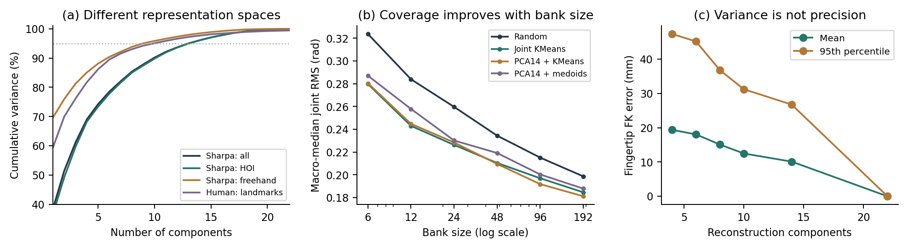
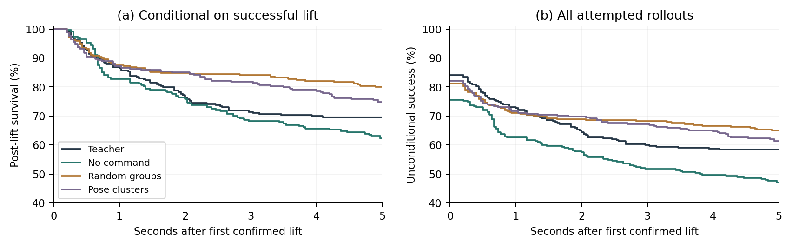
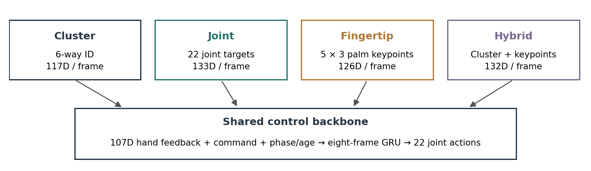

# RLDexAgents — Supplementary Report

*Dataset details, training procedures and extended experiments*

Supplementary material · Ruoqu Chen et al.

## 1. Large-Scale Hand Motion Data and Pose Manifold Analysis

### 1.1 Data units, sources and coverage

The training reference pool and the larger analysis collection are different datasets. A reference may be a segment of a parent capture; a sampled posture is a frame; a parallel environment slot is neither. Table 1 describes the established HOI pool used before the three-record RoboTool extension. The latest audited object-goal teacher uses 6,244 records in 8,192 environment slots. It does not use freehand data in that continuation.

| Training source | HOI reference records | Interpretation |
|---|---:|---|
| SPIDER-derived adapters | 1,386 | Multiple original datasets; retargeted references |
| Corrected human-wrist collection | 68 | Prepared right-hand HOI records |
| OakInk native | 600 | Selected prepared training stages |
| DexCanvas | 3,435 | Training windows, not unique raw recordings |
| DexterHand | 752 | Training windows from source sessions |
| **Established pool** | **6,241** | **3,185 unique parents in the clustering index** |
| RoboTool addition | 3 | Added in the 6,244-record teacher continuation |

*Table 1. Reference-pool accounting (E02/E04). Dataset counts are not episode counts across all raw collections.*

The full pose analysis indexes 1,029,112 Sharpa configurations from 13 adapter/source groups. DexCanvas dominates this collection: the expanded retarget collection contains 111,857 raw trajectories. Separately, an earlier 21,918-trajectory snapshot produced 61,822 windows, with 49,431 training windows, of which 3,435 entered the established teacher pool. SharpaDex contributes 12,771 freehand segments and 10,113,608 frames in its inventory; these provide unconstrained hand motion rather than object-interaction supervision. Earlier mixed training used freehand sampling, whereas E04 is HOI-only.

The data inventory also records expanded OakInk and HRDexDB retargeting beyond the established teacher set. OakInk has 627 source annotations and 2,840 stages; 711 earlier and 1,164 expanded successful retarget results are recorded, while 600 native stages enter the established teacher pool. HRDexDB has 441 human episodes, 246 SPIDER-derived short references and 194 newly prepared full trajectories. Availability, successful conversion and training inclusion are separate statuses.

### 1.2 Coordinates, normalization and retargeting

Sharpa pose analysis uses the ordered 22 right-hand joint angles. Human analysis uses normalized 60D landmark coordinates, with wrist removed and the remaining 20 landmarks expressed in a hand-local convention. Joint-space and landmark-space PCA have different units, constraints and weighting.

For a world-space fingertip position and palm transform, palm-local coordinates are:

$$p^{tip,palm}=R_{palm}^{T}(p^{tip,world}-p^{palm,world}).$$

Object-local contact coordinates use the analogous object transform. This makes coordinates consistent within an asset and trajectory, but does not automatically align the semantic axes of unrelated objects. A jug's native mesh frame need not have the same meaning as a tool's frame.

Retargeting fits robot joints to human or robot landmark targets under the robot's kinematics. Its output must still be checked against limits, mesh intersections and dynamic execution. For PCA, 14,068 indexed robot poses violate at least one URDF limit and are excluded. Some SPIDER source subsets have especially low valid fractions; the audit does not establish whether convention, retargeting or source processing is the cause. Such anomalies remain data-quality questions rather than grounds for silently changing joint order.

### 1.3 PCA, reconstruction and representative banks

For centered pose vectors, PCA projects onto the leading covariance eigenvectors and reconstructs in the original feature space:

$$z=U_k^T(q-\mu),\qquad \hat q=\mu+U_kz.$$

E01 partitions by trajectory key, caps fitting and test contributions by source, and obtains 8,867 fitting and 5,016 test samples. Representative-bank coverage is the nearest-entry joint RMS error, aggregated as the mean of source-wise medians. This prevents the largest source from alone determining the reported coverage:

$$d(q,B)=\min_{b\in B}\sqrt{\frac{1}{22}\sum_{j=1}^{22}(q_j-b_j)^2}.$$

The compared methods are random selection, joint KMeans, PCA+KMeans, approximate PCA+K-Medoids and a handcrafted posture taxonomy. All exported entries are actual limit-valid observations. KMeans centers are replaced by nearest observed configurations; they are not directly executed as synthetic mean poses. Medoids optimize representative selection within a finite candidate pool.

| Components | Variance retained | Joint RMS, rad | Fingertip mean / P95, mm | Poses outside limits before clipping |
|---:|---:|---:|---:|---:|
| 4 | 69.1% | 0.1958 | 19.38 / 47.34 | 44.0% |
| 6 | 78.5% | 0.1599 | 18.06 / 45.17 | 57.6% |
| 8 | 85.4% | 0.1313 | 15.09 / 36.78 | 60.0% |
| 10 | 90.2% | 0.1070 | 12.48 / 31.22 | 70.0% |
| 14 | 96.1% | 0.0717 | 10.11 / 26.74 | 76.0% |
| 22 | 100% | ≈0 | ≈0 / ≈0 | 0% |

*Table 2. E01 reconstruction. FK is evaluated after clipping; the limit-violation fraction is measured before clipping. Small boundary crossings count as violations, so the fraction need not decrease monotonically with component count.*



The filtered Sharpa all/HOI/freehand cohorts require 13/14/9 components for 95% variance; the normalized human landmark cohort requires 10. Complete variance curves, reconstruction errors and bank-size trends are more informative than a single threshold.

### 1.4 Contact-aware geometry and cross-embodiment analysis

E02 compares five representations at K=6 on the same 6,241 HOI reference records from 3,185 parent trajectories, taking one interaction configuration per record. Main-report Table 1 compares the representations' PCA variance and association with seven source/preparation groups.

**Feature content.** Joint-only features contain the 22 Sharpa joint angles. Legacy full relations contain palm–object, fingertip–object, proximity/distance and shape blocks, but no joint block. Fingertip relations plus joints add palm–object geometry, fingertip positions, proximity/distance and shape to joint posture. Link proximity plus joints uses palm–object geometry, 5 mm proximity labels for 26 links and object shape. The final link-proximity-and-distance representation additionally retains size-normalized clearance, clipped to [-0.05, 0.25]. This distinguishes continuous approach distances and includes palm and intermediate-phalange geometry. Proximity is computed from collision-geometry distances.

**Construction and weighting.** Each feature block is standardized per dimension, then multiplied by its block weight divided by the square root of its dimension. Block weights are 1 except for the explicit legacy-relation weights. KMeans uses inverse records-per-parent sample weights, with three restarts and n_init=10 per restart. PCA and the source diagnostics do not use these parent weights. Three-dimensional PCA is fitted separately for each representation; explained variance is measured before display-axis rescaling. The viewer and PCA-3 source silhouette divide each PC coordinate by that axis's standard deviation.

**Source-group diagnostics.** The seven groups contain DexCanvas 3,435; DexYCB 322; DexterHand 752; HOT3D 798; HRDexDB 194; OakInk 672; and OakInk (wrist-adapted) 68 records. OakInk's two preparation groups are retained in the statistics. NMI uses all records; Euclidean source silhouettes use up to 2,000 random records with seed 20261026. Both diagnostics use unweighted samples.

Source silhouette measures separation between source groups, and NMI measures cluster–source association. Legacy full relations has NMI 0.072 and includes a singleton cluster. Link proximity and link proximity plus distance have NMI 0.214 and 0.218. The full-feature and PCA-3 silhouettes capture the effect of dimensional truncation and axis rescaling. We use link proximity plus distance to retain continuous clearance and interaction geometry across the hand.

**Group count and stability.** Six groups provide a compact retrieval and command vocabulary. Earlier Sharpa joint-space experiments obtained silhouettes of approximately 0.198, 0.205, 0.195 and 0.204 for K=4, 6, 8 and 12. The near tie between K=6 and K=12 motivates the coarser six-group interface, which is held fixed throughout the HOI representation comparison.

The final six groups contain 2,278 / 1,560 / 624 / 644 / 374 / 761 records. Link proximity plus distance has parent-weighted cluster silhouette approximately 0.087 and restart ARI approximately 0.997; joint-only cluster silhouette is approximately 0.136. The groups have repeatable assignments and overlapping boundaries. Each can contain multiple pose representatives, objects and successful demonstrations.

Wuji Hand 2 provides a cross-embodiment probe (E03): 175 episodes, 95,890 frames, and 1,400 sampled poses. Twenty right-hand joints are mapped through Wuji FK to landmarks and independently fitted to Sharpa's 22 joints. Mean fingertip fit error is 4.13 mm, and the fitted poses populate several regions of the Sharpa joint-pose space. These results support geometry-based pose transfer across embodiments.

## 2. Reinforcement Learning Teacher Training

### 2.1 Reference-conditioned learning

We use a **SONIC-style reference-conditioned teacher**, adapting the Dex-X simulation and RL training framework [@chen2026dexx] to hand-only control. Retargeted HOI trajectories provide reference hand configurations, object motion and wrist trajectories. PPO [@schulman2017] optimizes finger actions through contact-rich simulation, while an external actuator controller executes the wrist reference.

The teacher has a reference encoder, a continuous latent representation and a feedback control network. The encoder summarizes the current and upcoming reference motion. The control network combines the latent with observed hand and object state to generate finger actions. A motion decoder reconstructs reference features as an auxiliary learning objective, and a privileged critic supports PPO optimization.

$$z_t=E_{ref}(\mathcal R_t,M_t),\qquad a_t=\pi_T(o_t^{priv},z_t).$$

The teacher observes recent hand-state history, object information and the full reference sequence over a short future horizon. Wrist state, including its position in the scene, provides context for coordinating finger control with externally executed motion.

The reference representation contains hand configuration, object pose, fingertip geometry, wrist pose and object motion. Validity masks select the available reference information. The continuous latent captures this motion context for the hand controller.

**Finger actions.** The learned policy outputs finger-joint targets. The runtime decodes normalized actions, smooths the targets and applies physical joint limits before sending them to the hand actuators.

**External wrist execution.** In simulation, a separate controller sends the reference wrist position and orientation to the wrist actuators at each control step. This moves the hand through the prescribed approach and manipulation trajectory while the learned policy adjusts the fingers from feedback. The matched teacher–student evaluation uses the same reference wrist trajectory for each policy and holds the final target during post-reference retention.

**Agent execution.** The arm controller supplies wrist motion for approach, lifting, transport and orientation changes. The hand policy remains responsible for finger control, using local motion and tactile feedback to respond as the arm moves. This division allows the hand controller to operate within an agent-directed arm–hand system.

### 2.2 Object-goal continuation and curricula

**Object-goal continuation.** We continue the reference-conditioned teacher with rewards for object position, orientation, fine pose accuracy and terminal pose. The full motion reference remains available to the teacher. Reference reconstruction and action-bound regularization complement the task reward.

**Interaction sampling.** Training covers the HOI reference pool with parallel simulation environments. Additional sampling emphasizes previously successful interactions with moderate contact forces. This increases exposure to useful contact behavior while retaining the range of objects and motions in the pool.

**Physical and sensing variation.** Training randomizes object mass, friction, center of mass and actuator response. Sensor noise, intermittent feedback and control delay expose the controller to variations in observation and execution.

**Spatial and wrist variation.** A shared spatial transformation moves the object and wrist references together, varying scene placement and orientation. Independent wrist offsets perturb the executed wrist trajectory while preserving the object target. These offsets are introduced smoothly after reset and expanded through a curriculum, encouraging the finger policy to accommodate approach errors.

**Temporal curriculum.** Episodes can begin at different points along a reference trajectory, exposing the teacher to contact establishment and sustained manipulation. Continued training carries forward the learned policy, normalization and curriculum progress.

**Successful interaction collection.** We retain teacher rollouts that lift the object with sustained multi-finger contact and maintain it after the reference ends. Their action labels support command-conditioned student learning under the same externally supplied wrist motion.

### 2.3 Teacher evaluation and adaptation limits

Reference-tracking success asks whether an execution follows a prescribed motion from its intended initialization. Goal-conditioned grasp success asks whether a hand can establish and retain a grasp from an open approach under a compact command. Changing the initialization can invalidate the first task without changing the controller itself. A reference that begins with a supported in-hand object is not automatically a tabletop acquisition demonstration.

The matched E07 teacher achieves 64/68 grasps on a success-selected student-held-out pool. In contrast, the broader E10 open-start test gives the older object-goal teacher 560/2,365 lift-and-tail-retention successes, and only 12/1,034 in its DexCanvas subgroup. The latter may reflect altered initial support and task intent as well as policy weakness; replay is required before attributing it to poor data. Teacher rollout selection thus needs task-aware initialization and actual success measurements, not a blanket assumption that a high-quality reference is a successful demonstration.

## 3. Command-Conditioned Student Distillation

### 3.1 Deployment observations and actions

The final student is a recurrent hand controller conditioned on **Cluster + phase**. Its feedback history contains joint positions and velocities, previous actions, palm-frame motion and fingertip-force measurements. Preprocessing aligns the force frames and joint ordering, normalizes the inputs and preserves sensor-validity information.

The command contains the cluster label, execution phase and elapsed phase time. The recurrent backbone combines this command with feedback history and produces normalized finger actions. The runtime converts these into joint targets:

$$q_t^{target}=b+s\odot a_t.$$

Targets pass through smoothing and physical joint limits. The external wrist controller moves the hand, and the recurrent student adjusts finger actions using the resulting local motion and contact feedback.


### 3.2 Mixed DAgger/PPO optimization

The final student is trained with a **mixed DAgger/PPO objective**. During each rollout the student controls the hand, and the reference-conditioned teacher labels the states reached by that student [@ross2011]. The imitation term fits these online action labels:

$$\mathcal L_{DAgger}=\mathbb E_{(h_t,c_t,s_t)\sim d_{\pi_S}}\|\pi_S(h_t,c_t)-\pi_T(s_t)\|_2^2.$$

The DAgger term learns the teacher's response at student-visited states. The PPO term uses the same student experience to optimize physical task return, with a privileged critic estimating value. The teacher retains its original reference observations throughout labeling.

The combined objective weights online DAgger imitation and clipped PPO optimization, together with value regression:

$$\mathcal L_{mix}=\lambda\mathcal L_{DAgger}+(1-\lambda)\mathcal L_{PPO}+\mathcal L_V.$$

$$\mathcal L_{PPO}=-\mathbb E[\min(\rho_t A_t,\mathrm{clip}(\rho_t,0.8,1.2)A_t)].$$

Here the ratio compares current and rollout action densities, and the advantage is normalized over active transitions. The implementation additionally uses a log-probability entropy proxy for its tanh-transformed Gaussian; the displayed PPO term isolates the clipped objective. Value loss is half the squared return error. The imitation labels and PPO objective therefore have different roles: reproducing the teacher's local action and improving the task return from student execution.

The mixing weight gradually shifts emphasis from teacher imitation toward task optimization after critic warm-up. Deployment uses the actor with local feedback and Cluster + phase commands.

Student-only post-training is a separate experiment (E11). Starting from the historical 28-task cluster student, 400 PPO updates use 496 environments and 31 references, including three RoboTool additions, without online teacher action labels. Nominal complete five-second retention improves from 5/28 to 8/28, but perturbed retention remains 7/28; short success remains 21/28 in both conditions. Tool-tail success remains 0/3. Its 1 N contact and short-window criteria differ from E06/E07. This limited result does not establish that reward-only continuation solves new-tool generalization.

### 3.3 Command targets and phase semantics

The final student uses a fixed cluster command during grasp execution. Phase information coordinates hand preparation, grasping and release, while the runtime tracks elapsed phase time. The teacher continues to observe its motion reference when labeling the student's visited states.

The deployed phase convention uses FORM for open-hand preparation, HOLD for teacher-supervised grasp execution and RELEASE for opening. The host coordinates these stages with the wrist approach and object motion.

Historical fixed-seed, fingertip, latent-prior and student-only RL experiments provide useful diagnostics, but change several factors simultaneously. For example, the 141-case gesture-swap study compares a 1,016-reference latent model against a differently trained 663-reference seed model. Its low latent command sensitivity is evidence about that model; it is not a fair architecture ranking. Similarly, increasing the physical expressiveness of a command cannot resolve conflicting action labels when hidden object or wrist context determines what the teacher does next.

## 4. Experiments and Results

### 4.1 RQ1: representation and coverage

At bank size 24, source-macro median joint RMS errors are 0.2263 rad for joint KMeans, 0.2264 for PCA-22 KMeans, 0.2285 for PCA-14 KMeans, 0.2301 for PCA-14 medoids, 0.2597 for random selection and 0.2655 for the handcrafted taxonomy (E01). The small difference among optimized banks does not show that PCA is necessary. Their improvement over random selection supports geometric organization at a fixed size.

| Bank size | Best tested clustering coverage, rad | Random coverage, rad |
|---:|---:|---:|
| 6 | 0.2761 | 0.3237 |
| 12 | 0.2430 | 0.2839 |
| 24 | 0.2263 | 0.2597 |
| 48 | 0.2095 | 0.2344 |
| 96 | 0.1918 | 0.2151 |
| 192 | 0.1811 | 0.1986 |

*Table 3. Bank-size sensitivity. “Best” is the minimum among tested clustering variants at each size, not a newly trained algorithm. All values are source-macro median nearest-entry RMS errors.*

Leave-one-source-out evaluation is harder: at K=24, source-averaged medians are approximately 0.2583 rad for joint KMeans and 0.2848 for random selection; at K=96 they are 0.2292 and 0.2423. At K=24, mean pairwise range-normalized diversity is 1.688 for random selection, 1.591 for joint KMeans, 1.544 for PCA-14 KMeans and 1.507 for PCA-14 medoids. Random selection has greater spread here despite worse coverage: diversity alone need not improve coverage of dense modes. Full diversity curves are included in the numeric bank metrics and supplementary plots. No bank undergoes comprehensive simulator self-collision or grasp feasibility validation in E01. Kinematic validity here means joint-limit validity and measured FK error, not physical executability.

### 4.2 RQ2: selection and full-data execution

E05 balances final link-near labels at 374 records/class. Its 2,244-reference evaluation obtains 362 sustained dual-finger lifts among 1,645 references containing at least a 2 cm lift target (22.0%). Strict last-window pose success is 35/2,244. A balanced geometric partition therefore does not produce a balanced or reliably executable grasp curriculum. Some classes contain predominantly small motions or little object contact.

E10 makes this distinction explicit with matched demonstration selection. Random and manifold-guided students each use 30 demonstrations, 60,000 teacher queries and 400 updates. Expanded evaluation excludes training parents and contains 2,365 references from 1,721 parents. Success requires lift establishment plus retention in the final 30 steps; it is not five-second HOLD.

| E10 evaluation subset | Teacher | Random selection | Manifold-guided |
|---|---:|---:|---:|
| All 2,365 references | 560 | 354 | 343 |
| 521 historical pick-and-pose successes | 147 | 106 | 100 |
| 2,060 references with ≥2 cm target lift | 553 | 348 | 335 |
| Strict lift plus final pose, all references | 89 | 32 | 14 |

*Table 4. Selection experiment. Guided−random overall difference is −0.47 percentage points; paired-parent bootstrap 95% interval [−2.13,+1.19] pp.*

An earlier 14-task subset favored guided selection 7 versus 5 successes, but that observation did not persist at scale. The interval includes zero and does not establish equivalence. Historical taxonomy fitting used broader data, and object identities are not held out. We interpret the result as absence of demonstrated execution benefit from this selection recipe, not evidence that manifolds are intrinsically unhelpful.

### 4.3 Command ablations and spatial robustness

E06 compares no command (E0), fixed random grouping (E1) and historical pose-cluster grouping (E2), using the same 28 selected tasks and training budget. The grouping labels are not the final link-near classes. Lift success requires elevation of at least 2 cm and at least two object-contacting fingers above 0.5 N continuously for 15 frames (0.5 seconds). One/five-second HOLD starts at reference completion, requires at least 95% valid frames and excludes a drop lasting 0.2 seconds. Raw fingertip force above 20 N is reported separately.

| E06 nominal model | Lift /28 | HOLD 1 s /28 | HOLD 5 s /28 | Drop among lifted |
|---|---:|---:|---:|---:|
| Teacher mixture | 24 | 20 | 17 | 6/24 |
| E0: no command | 20 | 16 | 13 | 7/20 |
| E1: fixed random groups | 24 | 20 | 17 | 6/24 |
| E2: pose clusters | 23 | 19 | 17 | 6/23 |

*Table 5. One nominal evaluation, not an unseen-task benchmark.*

A separate run applies five global and five relative perturbations per task: global object-and-wrist planar translations of 2–5 cm and yaw magnitudes of 10–20 degrees, or object-only translations up to 5 mm and yaw up to 5 degrees. Global five-second HOLD is E0 64/140, E1 92/140 and E2 82/140; relative HOLD is 64/140, 88/140 and 86/140. The task-paired E2−E1 intervals are [−22.86,+7.86] pp globally and [−17.14,+14.29] pp relatively. E2−E0 relative HOLD is +15.71 pp with interval [4.29,27.86]. Resampling uses tasks as units because perturbations of the same task are correlated. These intervals reflect evaluation variability conditional on one trained model per condition, not training-seed uncertainty.

The result is consistent with a benefit of stable command conditioning, but does not show a unique benefit of pose-derived groups. Random groups may help disambiguate task families or memorized references without acquiring physical semantics. Nominal results embedded in the spatial run differ slightly from the independent nominal run; we retain separate denominators rather than pooling them.

### 4.4 Contact stability

Contact analysis uses target-object-filtered finger forces, not raw fingertip force alone. A binary signature marks a finger active when force exceeds 0.5 N in at least half the first successful 15-frame interval. This five-finger signature omits contact location, surface normal and within-finger link identity. It cannot certify opposing contacts or force closure.

Post-lift survival starts at the first confirmed successful lift. Failure is a subsequent six-frame interruption of the lift-and-multifinger condition; RELEASE is right-censored. Conditional survival excludes never-lifted trials, whereas unconditional survival multiplies by the probability of first obtaining a lift:

$$P(\text{lift and survive }t)=P(\text{lift})\,S(t\mid\text{lift}).$$



| Model | Lifted /308 | Conditional 5 s survival | Unconditional 5 s success |
|---|---:|---:|---:|
| Teacher mixture | 259 | 69.5% | 58.4% |
| E0 | 233 | 62.2% | 47.1% |
| E1 | 250 | 80.0% | 64.9% |
| E2 | 253 | 74.7% | 61.4% |

*Table 6. Each conditional percentage uses that model's own successful-lift subset. It is not a matched-success comparison.*

On the separate 209 cases successfully lifted by both E1 and E2, E1/E2 average 2.52/2.37 contacting fingers, 0.95/1.22 contact interruptions, and 0.187/0.207 active-force coefficient of variation. E1 is more stable in these recorded statistics, but policy behavior and grouping change together. This does not establish that random labels causally improve contact. Pose classes also do not produce clearly stronger within-class contact consistency than random groups under the recorded signatures. Richer link-level contacts and repeated training seeds are required.

### 4.5 Matched interface-conditioned comparison


| Interface | Command | Conditioning |
|---|---|---|
| Cluster | Configuration-family label | Discrete grasp intent |
| Joint | Target hand configuration | Joint-space pose goal |
| Fingertip | Palm-frame fingertip targets | Endpoint geometry |
| Hybrid | Cluster label and fingertip targets | Discrete and geometric intent |

*Table 7. Four command interfaces share feedback processing and finger control. Each command includes execution phase and elapsed phase time.*



We compare Cluster, Joint, Fingertip and Hybrid as alternative student interfaces under a common teacher. Cluster uses a configuration-family label; Joint uses a target joint pose; Fingertip uses palm-frame fingertip goals; Hybrid combines the label and fingertip goals. All include execution phase and elapsed phase time. The final method uses Cluster + phase.

The comparison shares the success-selected pool, control backbone, initialization procedure, action interface and approximately matched mixed DAgger/PPO budget. Screening retains 340 successful parent trajectories for a 272/68 student train/test split. Joint targets use the teacher's actual hand pose at first confirmed lift; fingertip targets use FK of that same configuration in the palm frame. Hybrid combines these targets with the cluster label. The target command remains fixed during each rollout.

| E07 model | Lift /68 | HOLD 1 s /68 | HOLD 5 s /68 | Drop among lifted | Joint goal MAE, rad | Tip goal error, cm |
|---|---:|---:|---:|---:|---:|---:|
| Teacher | 64 | 60 | 54 | 7/64 | 0.232 | 3.42 |
| Cluster | 39 | 27 | 24 | 14/39 | 0.412 | 5.39 |
| Joint | 34 | 27 | 26 | 5/34 | 0.404 | 5.47 |
| Fingertip | 35 | 24 | 22 | 12/35 | 0.417 | 5.55 |
| Hybrid | 41 | 31 | 25 | 11/41 | 0.402 | 5.30 |

*Table 8. Goal errors average HOLD-frame deviations from the fixed teacher-derived target. The time-varying teacher itself need not remain at that static target.*

Hybrid has the most lifts (60.3%), whereas Joint has the most five-second HOLD successes (38.2%). Neither dominates all metrics. Joint's low drop fraction is conditional on the smaller set it lifts and cannot replace unconditional success. Fingertip and Hybrid do not materially reduce the approximately 5.3–5.6 cm student target errors relative to Cluster. The additional command coordinates are therefore not yet converted into substantially better target adherence by this recipe.

The gap also appears on the 272 training tasks: teacher/Cluster/Joint/Fingertip/Hybrid lift counts are 265/142/134/135/145, with five-second HOLD 209/91/93/98/93. Poor held-out performance is thus not explained solely by unseen parents. Candidate explanations include insufficient optimization, teacher–student observability mismatch, phase timing, action-label inconsistency under a fixed command, and inadequate contact-rich training coverage. Current data do not isolate these explanations. Cluster counts in the test set are 1/6/21/5/4/31, so class-specific percentages should not support strong general claims.

The historical latent-prior gesture-swap study further illustrates weak conditioning: fixed-state action changes under a replaced command average 0.017 rad in FORM and 0.008 in HOLD, versus 0.118/0.108 for its seed comparator. Latent original/swapped lift counts are 31/36 of 141; seed counts are 45/33. Different data and budgets preclude attributing these differences to the latent architecture. They motivate direct command-sensitivity tests alongside task success.

### 4.6 RQ3: toolkit and physical evidence

The toolkit supports model loading, pose retrieval, command dispatch, local feedback preprocessing and bounded joint-target generation. Its integration is distinct from autonomous grasp planning. Existing DexBench records contain infrastructure failures and safety stops with no confirmed end-to-end agent success in the audited runs. A tool being available in a registry does not imply it was successfully invoked by an LLM, and low-level policy success does not establish planning or retry success.

The local physical workflow record confirms three active cameras and hand connectivity but records `motion_sent=false` and the hand disabled. It supports read-only integration evidence. Separate user feedback reports good physical behavior of the earlier link-near mixed-PPO student; object identities, trial counts, HOLD duration and synchronized checkpoint-linked recordings were not preserved in the audited record. We report that feedback qualitatively and do not assign a real-world success rate to it or to the new four-interface policies.

## 5. Agentic Toolkit Implementation

### 5.1 Registry, retrieval and command compilation

The local `gesture_grasp_tool` package exposes pose references and trained controllers through agent tools. Pose-bank retrieval selects a hand configuration; skill-bank retrieval selects a policy and its supported command interface. A retrieved pose can supply a Joint or Fingertip command for a compatible controller, while a Cluster command selects a conditioning label within a trained policy. Command compilation validates input shapes and converts physical units into network normalization. A joint goal conditions the policy rather than overwriting its actions. Fingertip commands use palm-frame meters.

An illustrative supported call sequence is:

```python
from dex_agent.system0 import ClusterGraspTool

tool = ClusterGraspTool()
tool.call("cluster_grasp", {"cluster": 2, "phase": "FORM"})
# The host provides a current HandSample at each 30 Hz tick.
target_q_rad = tool.tick(sample)
status = tool.call("get_grasp_status")
tool.call("stop_grasp")
```

The host owns sensor acquisition, timestamp handling, wrist execution and hardware communication. Each policy is loaded with its corresponding command interface and observation preprocessing.

### 5.2 Execution and verification

The inspected runtime applies one action-smoothing stage, joint bounds and measured-to-target safeguards. The earlier `GraspSkill` adapter uses EMA coefficient 0.4 and a 1.5 rad measured-target cap. Joint order, action scale, force frame and previous-action semantics must agree with the checkpoint. These are implementation details required to reproduce its behavior; changing them can alter a closed-loop rollout even when the weights are identical.

The older API exposes `set_grasp`, `execute_phase` and `get_status`, with optional contact-triggered automatic HOLD. The newer link-near command tool uses explicit phases. These APIs should not be described as interchangeable state machines. Status can report force, phase and execution state, but hand load alone cannot identify the contacted object or certify that it was lifted. In particular, the old hand-only status leaves grasp success unknown unless an external outcome check supplies evidence.

Outcome verification combines the intended task criterion with observable evidence: object displacement and retention in simulation, or appropriate calibrated sensing on hardware. In the rule-based pose-registration workflow, this outcome is considered alongside pose novelty and compatibility with the target bank. An accepted entry adds a retrievable functional pose; it does not alter a trained policy. Skill-bank registration instead adds an executable controller with compatible preprocessing and execution semantics. Automatic training of missing policies, learned interface selection, Real2Sim verification and verified grasp-to-in-hand transitions remain research extensions.

## 6. Limitations and Future Work

Dataset imbalance remains substantial, and source balancing for geometric analysis does not automatically balance successful interactions. Retargeting and collision geometry can create source-dependent errors. Source-level generalization should be complemented by object- and parent-disjoint execution tests. Human landmarks, Wuji joints and Sharpa joints require representation-specific interpretation, and cross-hand contact equivalence has not been demonstrated.

Contact records are incomplete. Finger-level force aggregation omits contact normals, locations and link-level transitions. The next collection should preserve those measurements where available, alongside object motion and controller targets. This would support tests of effective finger roles, contact switching and grasp-to-in-hand transitions without inferring them from a low-dimensional plot.

Most learning comparisons use one training seed and limited optimization. Paired rollout intervals do not account for retraining variance. Repeated, approximately budget-matched experiments are needed before ranking interfaces or selection strategies. The teacher–student gap on training tasks particularly warrants longer optimization and a diagnostic separation of BC, online labeling and policy-gradient contributions.

Deployment removes object truth and future references while relying on tactile calibration, accurate hand kinematics and externally generated EEF trajectories. Perturbation tests with known references do not establish robustness to independently planned approaches. A new-tool experiment should report command validity, physical feasibility, conditional student execution and complete agent success separately.

Real-robot evidence needs repeated trials with named objects, checkpoint identity, synchronized sensor/video records, failure definitions and HOLD durations. Automatic policy acquisition, incremental policy updates, agent-selected command interfaces and Real2Sim outcome verification remain open engineering and research tasks.

## References

- [@santello1998] M. Santello, M. Flanders and J. F. Soechting. Postural Hand Synergies for Tool Use. *Journal of Neuroscience*, 18(23):10105–10115, 1998. [Publication record](https://pubmed.ncbi.nlm.nih.gov/9822764/).
- [@ross2011] S. Ross, G. Gordon and D. Bagnell. A Reduction of Imitation Learning and Structured Prediction to No-Regret Online Learning. *AISTATS*, PMLR 15:627–635, 2011. [Paper](https://proceedings.mlr.press/v15/ross11a.html).
- [@chen2026dexx] R. Chen, F. Ruan, L. Cao et al. Dex-X: Learning Visual-Tactile Dexterous Manipulation From Human Videos with Simulated Interaction. *arXiv:2609.07747*, 2026. Preprint. [Paper](https://arxiv.org/abs/2609.07747).
- [@schulman2017] J. Schulman, F. Wolski, P. Dhariwal, A. Radford and O. Klimov. Proximal Policy Optimization Algorithms. *arXiv:1707.06347*, 2017. Preprint. [Paper](https://arxiv.org/abs/1707.06347).
- [@pinto2018] L. Pinto, M. Andrychowicz, P. Welinder, W. Zaremba and P. Abbeel. Asymmetric Actor Critic for Image-Based Robot Learning. *Robotics: Science and Systems XIV*, 2018. [Paper](https://www.roboticsproceedings.org/rss14/p08.html).
- [@qi2023] H. Qi, A. Kumar, R. Calandra, Y. Ma and J. Malik. In-Hand Object Rotation via Rapid Motor Adaptation. *CoRL 2022*, PMLR 205:1722–1732, 2023. [Paper](https://proceedings.mlr.press/v205/qi23a.html). Related contact-rich adaptation work; not a direct experimental comparator here.
- [@ichter2023] B. Ichter, A. Brohan, Y. Chebotar et al. Do As I Can, Not As I Say: Grounding Language in Robotic Affordances. *CoRL 2022*, PMLR 205:287–318, 2023. [Paper](https://proceedings.mlr.press/v205/ichter23a.html).
