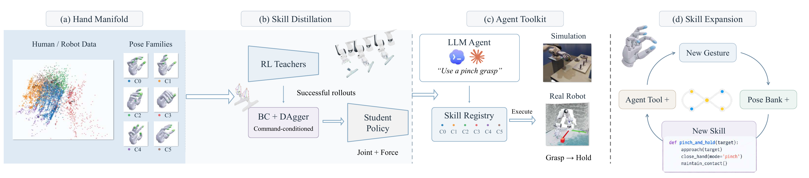
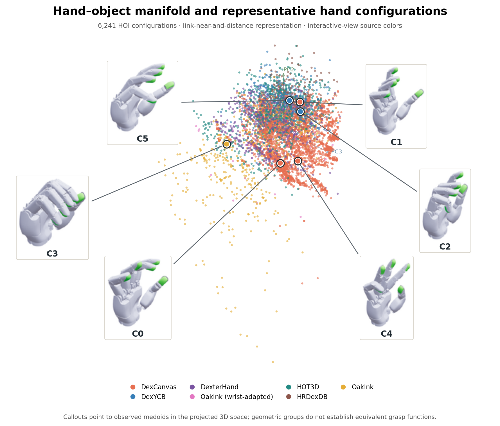
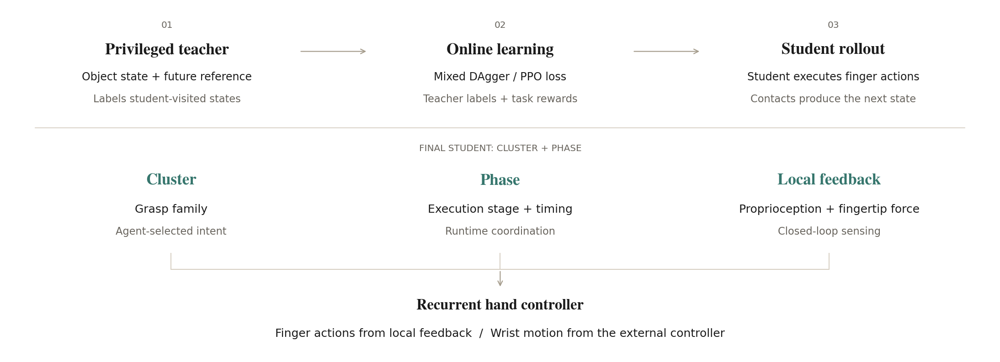
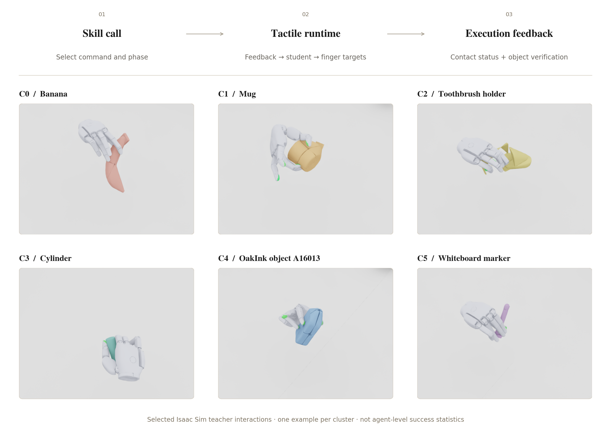

# RLDexAgents: An Extensible Dexterous Skill Toolkit for LLM Agents

*From Hand Pose Manifolds to Interface-Conditioned Skill Distillation and Agentic Manipulation*

Technical report · Sharpa right-hand implementation · 27 October 2026

## Abstract

Dexterous robots must turn plausible hand poses into stable physical interactions, while language agents need skills they can invoke without generating joint trajectories. RLDexAgents organizes quasi-static hand references in a pose bank and trained, executable policies in a skill bank, connecting motion data to reinforcement-learning teachers, command-conditioned students and an extensible agent toolkit. We analyze approximately 915K human poses, 1.03M Sharpa poses, and 1,400 Wuji2 samples. Representative pose banks improve geometric coverage. We train the final Cluster + phase student with mixed DAgger/PPO and study Joint, Fingertip and Hybrid commands in an interface ablation. On 68 student-held-out tasks, students achieve 50–60% grasp success versus 94% for the teacher; richer commands do not consistently improve retention or target adherence. The toolkit separates high-level skill selection, external wrist control, and 30 Hz tactile hand control. These results establish a working research pipeline while identifying command ambiguity, contact establishment, and teacher–student observation differences as central obstacles to reusable dexterous skills.

## 1. Introduction

General-purpose robotic agents should reason about and execute dexterous behaviors through high-level representations rather than directly generating high-dimensional joint trajectories. Large human and robotic hand-motion datasets contain diverse hand configurations and interaction priors. The challenge is to organize this information into simple interfaces that connect an agent's intent to physical execution.

Hand configurations and executable behaviors serve complementary roles. A quasi-static pose specifies a hand shape, while a trained feedback policy determines how finger actions respond to changing contact. Human–object interaction (HOI) datasets supply motion and contact context; reinforcement learning (RL) grounds those references in physically executed behavior. A useful agent interface must let the agent retrieve a pose reference or invoke a trained policy without conflating the two.

We ask: **can the structure of hand-pose distributions provide a useful intermediate representation between motion data and executable robotic skills?** RLDexAgents organizes representative configurations into a **pose bank** and trained, executable policies into a **skill bank**. Physical teacher rollouts connect motion references to successful interactions, and distillation produces closed-loop policies conditioned on compact commands. The toolkit exposes both banks to agents: a pose can specify a desired configuration, and a compatible skill supplies feedback control during execution.



Three insights guide this progression. **Representation:** coordinated hand-pose variation supports compact organization. **Learning:** successful RL interactions ground motion references in physical behavior. **Interface:** command design determines how agents specify and control trained skills.

The contributions are correspondingly focused:

- **Manifold-guided skill organization:** large-scale motion analysis and interaction-aware clustering organize pose families and representative skill candidates, with separate banks for quasi-static pose references and trained policies.
- **Command-conditioned skill distillation:** successful RL teacher behaviors are distilled into closed-loop students driven by compact commands and sensor feedback, with a matched comparison of Cluster, Joint, Fingertip and Hybrid interfaces.
- **An extensible agentic toolkit:** a unified interface for registering, retrieving, executing and evaluating dexterous capabilities, with distinct handling of pose references, policy execution and outcome feedback.

Hand-synergy research motivates studying coordinated posture variation [@santello1998]. DAgger motivates learning from states the student actually visits [@ross2011], while asymmetric learning permits privileged training information [@pinto2018]. Language-grounded skill selection motivates delegating execution to controllers rather than producing low-level actions directly [@ichter2023]. Our experiments connect these ideas within an existing Isaac Lab and Sharpa pipeline.

## 2. From Hand Motions to Pose Manifolds

### 2.1 A diverse motion collection

The analysis brings together approximately **915K human landmark poses**, **1.03M Sharpa joint poses**, and **1,400 sampled Wuji Hand 2 poses**. Human HOI spans objects and contact-rich activities from sources including DexYCB, HOT3D, OakInk and HRDexDB. Sharpa data combines retargeted interactions, DexCanvas and DexterHand motions, and SharpaDex freehand movement. Wuji2 provides a separate embodiment for a preliminary kinematic comparison.

This diversity is useful but difficult to consume directly. Sources differ in hand representation, sampling density, object geometry and task intent. Freehand data explores configurations without requiring object support; HOI places the hand in object-dependent relationships. Dense sampling from a large source can dominate a naive average or clustering result. We therefore preserve source and parent-trajectory identity and use source-balanced fitting for the quantitative pose-bank analysis. Detailed collection versions and retargeting counts are deferred to the supplementary inventory.

Human analysis uses normalized hand-local landmarks, while Sharpa analysis uses 22 ordered joint angles. Wuji2 landmarks are obtained by forward kinematics (FK) and fitted to Sharpa for a cross-hand probe. Joint-limit checking and FK quantify geometric validity.

### 2.2 Structure of the hand pose space

Principal component analysis (PCA) measures coordinated variation in a chosen representation. For a joint pose, projection and reconstruction are:

$$z=U_k^T(q-\mu),\qquad \hat q=\mu+U_kz.$$

The data exhibit substantial statistical structure: many joint or landmark coordinates vary together, and different sources occupy different parts of the distribution. Sharpa freehand and HOI cohorts have different variance profiles, consistent with their different constraints. This supports organizing motions into posture families.



We use a 95% explained-variance threshold to summarize linear compression and pair it with reconstruction and coverage measurements. Fingertip reconstruction error captures the spatial precision relevant to small contacts.

### 2.3 Structured pose and skill banks

Clustering provides a compact vocabulary of configurations. Our interaction-oriented representation combines joint posture with hand–object geometry, including which hand links are near the object and their distances. It organizes 6,241 selected HOI configurations into six groups, C0–C5.

The two banks store different kinds of entries. A **pose bank** stores quasi-static hand configurations and associated fingertip geometry, together with source and task context. Manifold-derived entries are observed representative configurations. The bank can also incorporate task-specific functional poses discovered during agent execution, extending the set of retrievable hand configurations.

A **skill bank** contains trained, executable policies and the metadata needed to invoke them: command type, observation preprocessing, action decoding and supported execution conditions. A pose retrieved from the pose bank may be compiled into a command for a compatible policy. One policy can accept many pose commands. Here, a **skill candidate** means a pose paired with an intended interaction for physical evaluation, before a suitable executable controller and its conditions have been established.

Joint-space KMeans and PCA-based pose selection improve nearest-entry coverage relative to random selection at a fixed bank size. Medoid selection provides observed examples for retrieval.

Hand–object geometry connects pose organization to physical interaction. Similar hand shapes can produce different contacts across objects, so we evaluate candidate poses through RL execution and collect successful interactions for distillation.

## 3. Learning Executable Dexterous Skills

We use a **SONIC-style reference-conditioned teacher** to learn dexterous finger control from human–object interaction references. Building on the simulation and RL training framework of Dex-X [@chen2026dexx], we adapt learning to a **hand-only action policy**: the policy produces finger-joint targets, while a separate controller supplies wrist motion. The hand learns to establish and maintain contact as the wrist approaches, lifts and moves the object.

The teacher separates reference encoding from feedback control. A reference encoder maps the current and upcoming hand–object motion into a continuous latent representation. A control network combines this representation with hand-state history and object observations to produce finger actions. An auxiliary decoder reconstructs reference motion, encouraging the latent to retain information useful for tracking. PPO [@schulman2017] trains the controller through simulated physical interaction.

**Hand-only adaptation of Dex-X.** Retargeted HOI trajectories provide the hand, object and wrist references used in simulation. We train across diverse objects and interactions, then continue the teacher with object-pose objectives and prioritize successful interactions with moderate contact forces. This focuses learning on finger behavior that supports the intended object motion.

The continuation rewards object position, orientation, fine pose accuracy and terminal pose. Reference reconstruction and action-bound regularization accompany the task objective. Successful lift-and-hold rollouts are selected as demonstrations for command-conditioned distillation.

**Wrist motion.** During teacher training and the matched student evaluations, a separate actuator controller tracks the wrist position and orientation from the HOI reference. At reference completion, it maintains the final wrist target during the HOLD period. Training applies shared spatial transformations to the scene and references, together with independent wrist execution offsets, so the hand policy learns under variations in placement and approach. In agent execution, the arm controller supplies the approach, transport and wrist-orientation commands, while the hand policy reacts to proprioceptive and fingertip-force feedback.

**Distillation data.** We collect teacher rollouts with sustained multi-finger contact, successful object lift and continued retention after reference completion. These interactions provide action supervision for students driven by compact commands and local feedback.

Distillation transfers reference-conditioned behavior to compact agent commands and local sensor feedback. It addresses the transition from reference tracking, which can begin with a supported object, to grasp control with an externally supplied approach.

## 4. Interface-Conditioned Skill Distillation

### 4.1 The final closed-loop student

Our final student uses a **Cluster + phase command** together with local proprioceptive and fingertip-force feedback. The cluster selects the grasp family, and phase specifies the execution stage. The recurrent policy maps feedback history and this compact command to finger actions:

$$a_t=\pi_\theta(H_t,c_t).$$

The student observes a recent history of joint positions and velocities, previous actions, palm-frame motion and fingertip-force feedback. A recurrent controller combines this history with the active command and produces finger-joint targets. Wrist execution remains with the external controller.

The command carries cluster and phase information, including elapsed phase time. The feedback history supplies the hand state and contact measurements needed for closed-loop execution.

### 4.2 Cluster and phase conditioning

The final policy uses a discrete cluster label to select grasp intent and phase information to coordinate preparation, grasp execution and release. The runtime maintains phase timing and supplies the command alongside sensor history. Joint-pose and fingertip targets are evaluated as alternative interfaces in the experiments.



During execution, the agent selects the cluster and phase, the hand controller responds to local feedback, and the external arm controller supplies wrist motion.

This compact interface exposes the trained grasp behavior through a small set of agent commands. The interface ablation in Section 6 compares it with more detailed geometric commands.

### 4.3 Mixed DAgger/PPO distillation

We train the student with a **mixed DAgger/PPO loss**. The student executes the rollout, and the teacher provides action labels at the states it visits. The DAgger imitation term minimizes disagreement with these labels, while the PPO term optimizes physical task return. A value loss trains the critic.

Training combines the DAgger imitation and PPO objectives with a scheduled mixing weight. The teacher keeps its full reference and object observations when labeling student-visited states. The student actor receives local sensor history and Cluster + phase commands, while a privileged critic supports training.

Online teacher labeling teaches recovery from student-generated states, and PPO improves contact behavior through task feedback. Together, these objectives train the final Cluster + phase student for closed-loop finger control.

## 5. An Extensible Toolkit for LLM Agents

Given an object and a grasp instruction, the agent can retrieve a functional hand pose or select a trained skill. Pose retrieval supplies a quasi-static configuration to a supported pose-execution interface or a compatible command-conditioned policy. Skill retrieval selects the trained feedback controller that executes the behavior. The agent handles low-rate intent and tool selection, while the runtime handles finger control and coordinates with the external wrist controller.

The toolkit exposes pose-bank retrieval, skill-bank lookup, command compilation, policy loading, observation preprocessing and status feedback. The final grasp skill accepts Cluster + phase commands. Pose references remain available through the pose-bank interface. The execution host maintains sensor history and decodes the grasp policy's finger actions while coordinating with the wrist controller.

A supported command sequence is:

```python
tool.call("cluster_grasp", {"cluster": 2, "phase": "FORM"})
target_q_rad = tool.tick(sample)  # host-supplied hand feedback
status = tool.call("get_grasp_status")
```

The host uses the phase semantics associated with the checkpoint and coordinates the approach and outcome verification. The compact API delegates 30 Hz finger control to the policy.



The local gallery contains representative poses and successful Isaac Sim teacher interactions for all six final clusters. Real-world deployment videos provide qualitative examples of the integrated system.

The rule-based pose-registration workflow described here uses episode outcomes, pose novelty and bank compatibility to decide whether a task-specific functional configuration should be stored for future retrieval. This expands the pose bank with a reusable reference. Adding a skill-bank entry instead requires a trained executable policy with a supported runtime interface.

The surrounding system verifies object-level outcomes. Future extensions include training missing policies, learned interface selection and grasp-to-in-hand composition.

## 6. Experiments and Key Findings

We focus on three questions: how representation choice organizes pose and interaction structure, whether command conditioning improves stable execution, and how command expressivity affects distillation. Detailed protocols, historical experiments and per-source breakdowns are retained in the [supplementary report](supplementary_report.html).

### Result A: pose structure depends on representation

We compare five HOI representations on the same records to distinguish hand-shape structure from interaction geometry. Joint-only features describe posture; fingertip and link features add object-relative relations. The final representation includes proximity and size-normalized clearance for 26 hand links, capturing palm and intermediate-phalange geometry as well as fingertips. Table 1 reports variance retained by the 3D projection and association with source/preparation groups.

| HOI representation | PC1–3 variance | Cluster–source NMI | Source silhouette: full features | Source silhouette: scaled PCA-3 |
|---|---:|---:|---:|---:|
| Joint only | 49.6% | 0.308 | 0.064 | 0.056 |
| Legacy relations (no joints) | 41.3% | 0.072 | -0.117 | -0.225 |
| Fingertip relations + joints | 31.9% | 0.252 | 0.024 | -0.100 |
| Link proximity + joints | 32.0% | 0.214 | 0.056 | -0.049 |
| Link proximity + distance + joints | 33.8% | 0.218 | 0.050 | -0.076 |

*Table 1. Five HOI representations on 6,241 records from 3,185 parent trajectories, with K=6. Source silhouette measures separation across seven source/preparation groups; PCA-3 coordinates are standardized per axis. NMI uses all records and silhouettes use up to 2,000 sampled records.*

**Representation structure.** Three PCs retain 49.6% of joint-only variance and 31.9–33.8% for joint-plus-interaction features. Interaction geometry distributes variation across more dimensions. Link proximity plus distance retains palm and intermediate-phalange relationships together with continuous clearance, providing a richer representation for interaction retrieval.

**Compact grouping.** K=6 provides a compact vocabulary for retrieval and command conditioning. Earlier joint-space scores were nearly tied at K=6 and K=12 (0.205 and 0.204). The selected link representation has restart ARI approximately 0.997 and cluster silhouette approximately 0.087, yielding repeatable groups with overlapping boundaries. Each group can contain multiple pose references and demonstrations.

**Coverage and cross-hand structure.** A 24-entry joint-space pose bank reduces source-macro median nearest-entry joint RMS from 0.260 rad for random selection to 0.226 rad on a trajectory-key split. PCA-14 reconstruction has 10.1 mm mean fingertip FK error after clipping. Human normalized landmarks need 10 PCs for 95% variance; limit-valid Sharpa joints need 13 overall, 14 for HOI and 9 for freehand. Fitting 1,400 Wuji2 poses to Sharpa yields 4.13 mm mean fingertip error. These results support compact pose organization and cross-hand kinematic correspondence.

The expanded manifold-guided demonstration-selection experiment performed similarly to quota-matched random selection. Geometry provides an effective basis for organizing pose candidates, while execution experiments assess the resulting control behavior.

### Result B: command conditioning and contact retention

On 28 selected tasks, no-command, fixed-random-group and pose-cluster students achieve 13, 17 and 17 five-second HOLD successes, respectively. Fixed conditioning improves the observed HOLD count, with equal counts for random and pose-cluster grouping.

In the perturbation and contact analysis, five-second post-lift conditional survival is 62.2%, 80.0% and 74.7%, respectively, evaluated on each model's successful lifts. The random-group student also has fewer interruptions in the matched-success comparison. Task-paired intervals overlap for random and pose-cluster grouping. These experiments use one training seed and correlated perturbations of the same tasks.

### Result C: expressivity and execution do not improve together

We evaluate four student command interfaces as an ablation: **Cluster** supplies a configuration-family label; **Joint** supplies a target hand pose; **Fingertip** supplies palm-frame fingertip targets; and **Hybrid** combines a cluster label with fingertip targets. Each includes phase information. Our final student uses Cluster + phase.

The four students share one teacher, control architecture, pretrained backbone, success-selected pool and an approximately matched mixed DAgger/PPO budget. New command-input weights are initialized consistently. The teacher supplies 340 successful parent trajectories, split into 272 training and 68 student-held-out tasks. Joint and Fingertip commands come from the same successful teacher configuration, and Hybrid adds its cluster label.

| Policy / interface | Grasp success | Five-second HOLD |
|---|---:|---:|
| Teacher | 64/68 · 94.1% | 54/68 · 79.4% |
| Cluster | 39/68 · 57.4% | 24/68 · 35.3% |
| Joint | 34/68 · 50.0% | 26/68 · 38.2% |
| Fingertip | 35/68 · 51.5% | 22/68 · 32.4% |
| Hybrid | 41/68 · 60.3% | 25/68 · 36.8% |

*Table 2. Matched nominal execution. Grasp requires at least 2 cm lift and sustained dual-finger object contact for 0.5 s. HOLD is evaluated from reference completion. All percentages use the same 68-task denominator.*

Hybrid obtains the most grasps, while Joint obtains the most five-second HOLD successes. Continuous targets yield similar measured fingertip adherence under this recipe. The teacher–student gap also persists on training tasks, motivating further study of observation asymmetry, phase timing, optimization and command ambiguity.

## 7. Discussion and Outlook

The results connect three components: **representation** organizes motion into pose candidates; **learning** turns reference motions into physically executed demonstrations; and **interface design** exposes trained controllers through compact commands. Their joint design determines how effectively an agent can retrieve and execute dexterous behaviors.

This suggests three near-term priorities. First, represent the contact-establishment transition, not only a representative grasp frame, and collect multiple feasible commands for the same object and approach. Second, diagnose teacher–student disagreement on student-visited states and repeat matched interface experiments with more training seeds and optimization. Third, evaluate independently generated commands with an external wrist planner, separating command feasibility, conditional policy execution and end-to-end task success.

Current limitations include source imbalance, imperfect retargeting, incomplete link-level contact measurements, the privileged-to-tactile observation gap and single-seed learning comparisons. Real-world demonstrations are qualitative; repeated task-level trials are needed to quantify deployment performance. Automatic policy acquisition and Real2Sim verification are future directions.

RLDexAgents provides a working path from hand motion structure to executable, agent-callable control. Its current value is a shared representation, learning and runtime framework in which those boundaries can be tested. The next step is to make command-conditioned contact behavior reliable enough that an agent can reuse a skill beyond the reference that originally taught it.

## Supplementary Material

The [extended evidence report](supplementary_report.html) contains full dataset accounting, teacher configurations, historical distillation comparisons, expanded selection evaluation and contact-survival analysis. The [interactive gallery](pose_hoi_manifold.html) contains the complete 3D manifold, representative poses and replay videos. These materials preserve the detailed evidence without interrupting the main narrative.

## References

- [@santello1998] M. Santello, M. Flanders and J. F. Soechting. Postural Hand Synergies for Tool Use. *Journal of Neuroscience*, 18(23):10105–10115, 1998. [Publication](https://pubmed.ncbi.nlm.nih.gov/9822764/).
- [@ross2011] S. Ross, G. Gordon and D. Bagnell. A Reduction of Imitation Learning and Structured Prediction to No-Regret Online Learning. *AISTATS*, PMLR 15:627–635, 2011. [Paper](https://proceedings.mlr.press/v15/ross11a.html).
- [@chen2026dexx] R. Chen, F. Ruan, L. Cao et al. Dex-X: Learning Visual-Tactile Dexterous Manipulation From Human Videos with Simulated Interaction. *arXiv:2609.07747*, 2026. Preprint. [Paper](https://arxiv.org/abs/2609.07747).
- [@schulman2017] J. Schulman, F. Wolski, P. Dhariwal, A. Radford and O. Klimov. Proximal Policy Optimization Algorithms. *arXiv:1707.06347*, 2017. Preprint. [Paper](https://arxiv.org/abs/1707.06347).
- [@pinto2018] L. Pinto, M. Andrychowicz, P. Welinder, W. Zaremba and P. Abbeel. Asymmetric Actor Critic for Image-Based Robot Learning. *Robotics: Science and Systems XIV*, 2018. [Paper](https://www.roboticsproceedings.org/rss14/p08.html).
- [@ichter2023] B. Ichter, A. Brohan, Y. Chebotar et al. Do As I Can, Not As I Say: Grounding Language in Robotic Affordances. *CoRL 2022*, PMLR 205:287–318, 2023. [Paper](https://proceedings.mlr.press/v205/ichter23a.html).
