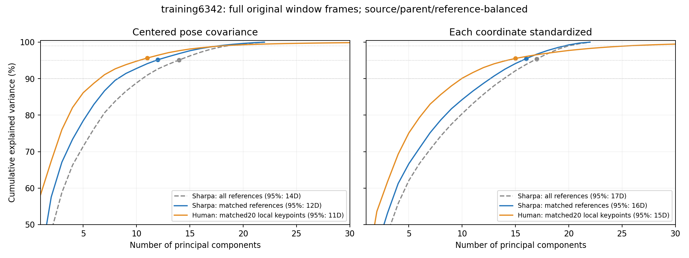
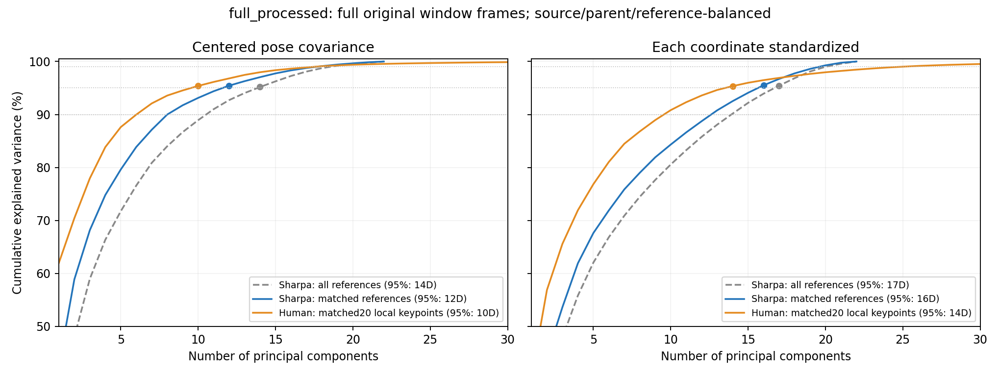

# Sharpa与人手PCA维数统计（2026-10-18）

查看PCA点云与姿态cluster分析（原始来源路径：`hand_pose_projection_clusters_20261018.md`）

## 主要结果：当前6342条训练清单

以**保留累计方差所需最少主成分数**定义PCA维数，不预设32维。主表只中心化、不逐坐标标准化；按来源→源序列/parent→reference平衡，reference内所有窗口帧等权。

| 数据 | 输入表示 | reference数 | 窗口帧实例 | 90% | 95% | 99% |
|---|---|---:|---:|---:|---:|---:|
| Sharpa全部 | 22维关节角 | 6,342 | 1,338,901 | 11 | **14** | 19 |
| Sharpa严格配对 | 22维关节角 | 4,855 | 1,053,876 | 9 | **12** | 18 |
| 人手严格配对 | 20关键点×3，局部、手长归一化 | 4,855 | 1,053,876 | 7 | **11** | 19 |

**同一批4855条配对reference上，95%方差：Sharpa12维，人手11维；99%方差：Sharpa18维，人手19维。** 当前完整训练清单的Sharpa95%为14维，其中还包括没有配对人手关键点的SPIDER1386条和free hand101条。

## 完整已处理数据池

| 数据 | 输入表示 | reference数 | 窗口帧实例 | 90% | 95% | 99% |
|---|---|---:|---:|---:|---:|---:|
| Sharpa全部 | 22维关节角 | 52,448 | 9,915,731 | 11 | **14** | 19 |
| Sharpa严格配对 | 22维关节角 | 50,961 | 9,630,706 | 9 | **12** | 18 |
| 人手严格配对 | 20关键点×3，局部、手长归一化 | 50,961 | 9,630,706 | 7 | **10** | 18 |

全池52448条包含未全部加入当前训练的DexCanvas窗口及OakInk部分val/test；这里只做描述性统计，不作为留出评测。严格配对池50961条，source/parent对齐。多个窗口可能重复引用同一源帧，因此上表是窗口帧实例数，不是唯一源帧数或独立示范数。

## 缩放方式的影响

| 当前训练数据 | 只中心化95% / 99% | 坐标单位方差95% / 99% |
|---|---:|---:|
| Sharpa全部 | 14 / 19 | 17 / 21 |
| Sharpa严格配对 | 12 / 18 | 16 / 20 |
| 人手严格配对 | 11 / 19 | 15 / 26 |

逐坐标标准化会抬高原本小幅运动坐标的权重，因此维数增加。原始窗口帧等权、来源/parent平衡两种统计均保留在dimensions.csv，不能混用口径。人手这里采用与前一轮聚类相同的60维局部几何表示，**不是MANO45维关节旋转**；人手与Sharpa参数空间不同，不能用维数大小直接判断retarget好坏。

## 各阶段：当前训练的严格配对参考

| 阶段 | Sharpa90% | 人手90% | Sharpa95% | 人手95% | Sharpa99% | 人手99% |
|---|---:|---:|---:|---:|---:|---:|
| reach | 6 | 5 | 8 | 7 | 15 | 14 |
| grasp | 9 | 8 | 13 | 12 | 19 | 20 |
| lift | 10 | 9 | 13 | 12 | 19 | 20 |
| hold | 8 | 7 | 12 | 10 | 18 | 17 |
| place | 9 | 8 | 13 | 12 | 18 | 20 |
| release | 8 | 6 | 11 | 9 | 17 | 16 |
| in_hand_interaction | 9 | 7 | 12 | 11 | 18 | 19 |
| unknown | 7 | 5 | 10 | 7 | 17 | 15 |

阶段统计沿用既有几何建议；只有1帧的608个细碎阶段在前次阶段提取中跳过，所以阶段表不覆盖这些帧，但本轮整体all统计已读入每条reference全部帧。人手数据缺失的SPIDER和free hand不补造。

## 与上次“PCA32”的区别

上次聚类的32是人为设置的投影上限，输入是整段动作描述符，并非单帧手型。补算相同8000个拟合片段、同样RobustScaler/截断/特征块加权后的完整PCA谱：

| 阶段描述符 | 输入维数 | 90% | 95% | 99% |
|---|---:|---:|---:|---:|
| robot | 264 | 77 | 106 | 162 |
| robot_matched | 264 | 72 | 104 | 165 |
| human | 720 | 98 | 139 | 255 |

阶段描述符同时包含姿态、变化、速度与多时刻形状，不能把它的维数称为手部物理自由度，也不能据此直接指定policy latent维数。单帧姿态较低维，不代表相同维数足够保存精确指尖、接触或闭环控制信息。

## 计算与验证

所有reference经现有loader读原始全部帧，机器人关节不做新的clip；人手沿用已验证的关键点顺序/MCP局部坐标/手长归一化。通过累积一阶、二阶矩求完整协方差特征谱，不做原先每阶段8帧采样，也不加载训练checkpoint。全池和当前训练清单均无加载错误。

source-parent-reference平衡定义：每条reference内帧均匀平均，同一source-parent内reference等权，source内parent等权，最终各source等权。raw_window_frames结果则每个窗口帧实例等权。各阶段单独计算自身的均值和PCA基，不与全局基混用。

已验证低秩合成数据的99%维数与零方差处理；人手与配对Sharpa帧数及各source的reference数一致；累计谱单调且总和为1，维数不超过输入空间。

远端：`/mnt/cpfs/workspace/rq_ws/outputs/hand_pose_pca_20261018/`，当前训练子目录training6342。1006两次SSH连接被关闭，改由1002从共享CPFS核验原任务已经正常完成，没有重复启动该任务；当前训练清单的CPU统计在空闲1000运行。未占训练GPU、未修改训练。

本地结果：`audit/hand_pose_pca_20261018/`，summary.json为全池，training6342/summary.json为当前训练，dimensions.csv包含按source、phase、缩放、权重的全部维数。components.npz保留主表PCA基。代码：scripts/analyze_hand_pose_pca.py、scripts/report_hand_pose_pca.py。

