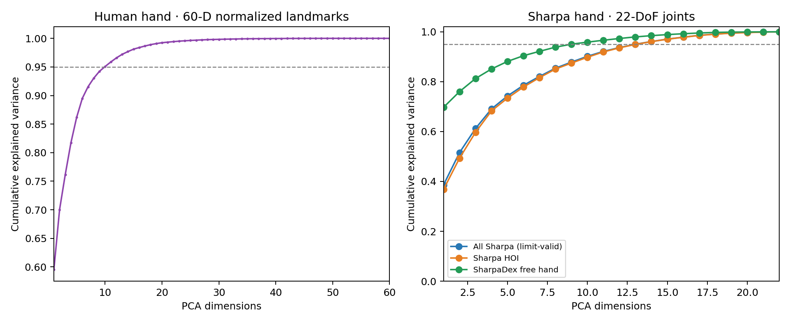
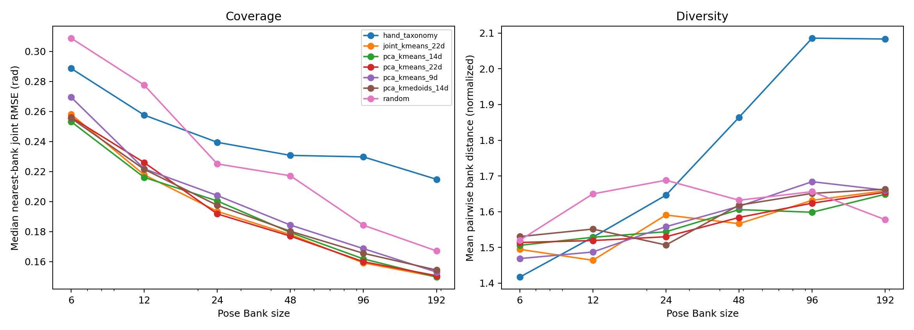

# E1：Sharpa Pose Manifold 表示与 Pose Bank 覆盖

日期：2026-10-27

## 研究问题

当前手姿聚类是否比随机采样或简单语义规则更有效地组织 Sharpa 姿态？本实验统一在 Sharpa 右手 **22-DoF** 关节空间评价候选 Pose Bank，并检查不同维数 PCA 的形状重建误差、覆盖、代表姿态多样性和跨来源泛化。

## 主要结论

1. **聚类 Pose Bank 的几何覆盖优于同规模随机 Bank。** 在有效限位数据的来源宏平均测试中，最优 KMeans Bank 的中位最近姿态误差从 K=6 的 **0.276 rad** 降到 K=192 的 **0.181 rad**；同规模随机 Bank 分别为 **0.324 rad** 和 **0.199 rad**。从 6 增到 24、96、192 都继续改善，但单纯几何距离尚不能说明这些姿态更适合执行抓取。
2. **22D Joint KMeans 与 PCA+KMeans 的覆盖接近。** K=24 时 Joint KMeans 和 PCA+KMeans-22D 的来源宏平均误差分别为 **0.2263** 和 **0.2264 rad**；K=96/192 时 PCA+KMeans-14D 略优。差异远小于“聚类对随机采样”的收益，当前没有证据表明 PCA 降维是 Pose Bank 覆盖的必要条件。
3. **K-Medoids 没有在覆盖上胜过 KMeans。** K=24 时 PCA-14D Medoids 为 **0.2301 rad**，PCA-14D KMeans 为 **0.2285 rad**；K=96 时分别为 **0.2003** 和 **0.1918 rad**。KMedoids 仍提供真实样本代表，但本实验中的 KMeans Bank 也已把每个中心替换成训练集中最近的真实姿态，所以两类 Bank 都不是平均出来的合成关节角。
4. **当前手工 taxonomy 过于粗糙，不适合做几何覆盖基线的优胜方案。** 它在 K=6 时好于随机，但在 K≥24 时明显落后于聚类 Bank；不过其姿态标签可解释，仍可能适合作为上层选择器或语义目录。
5. **95% 方差不等于可用的姿态重建精度。** PCA-14 保留 **96.1%** 方差，但限位裁剪后的指尖 FK 误差均值仍为 **10.1 mm**，P95 为 **26.7 mm**；压缩姿态若用于精确指尖/接触目标，单看解释方差会高估其质量。
6. **当前全量 Sharpa 收集里有需要先处理的 SPIDER 限位异常。** 1,029,112 帧中有 14,068 帧（**1.37%**）超出右手 URDF 限位；SPIDER 各来源只有约 **10–25%** 帧通过限位检查。为避免 source-balanced PCA 被异常关节值放大，E1 的正式银行和测试均使用限位内姿态，并另行记录剔除比例。

## 数据与拆分

- 来源：既有 `hand_pose_cluster_all_20261023/full_collection` 的 13 个 Sharpa 姿态来源，共 **1,029,112** 个有效索引姿态。矩阵按容量预分配，多出的 4,800 行尾部空间没有纳入实验。
- 限位筛选：逐帧按 right_sharpa_floating.urdf（原始来源路径：`../source/dexhand_hoi_learning/dexhand_hoi_learning/assets/generated/right_sharpa_floating.urdf`） 的 22 个关节上下限判定；**1,015,044** 帧在限位内，14,068 帧被排除。没有把超限角度裁剪后当作原始训练样本。
- 训练/测试：按 `source + trajectory key` 拆分，每条轨迹的采样帧不会跨训练/测试；每个来源先留出 20% key。训练拟合每来源最多取 1,200 帧，常规测试每来源最多取 1,000 帧，最后得到 **8,867** 个训练姿态和 **5,016** 个测试姿态。统计结果同时报告 pooled 和来源宏平均，避免 DexCanvas 帧数单独主导。
- 跨来源测试：逐一整来源留出，其他来源每个最多取 600 个训练姿态；测试集来自被留出的完整来源。共 13 个 held-out sources，报告 K=24 和 K=96，共 130 个方法/来源/Bank-size 结果。
- 关节距离：覆盖误差同时报告原始关节 RMS（rad），以及按每个关节 URDF 允许范围归一化后的 RMS。多样性使用 Bank 内两两关节范围归一化欧氏距离的均值。

### 限位有效率（来源检查）

| 来源 | 原始姿态数 | 限位内比例 |
|---|---:|---:|
| DexCanvas | 894,856 | 100.00% |
| DexterHand | 64 | 100.00% |
| OakInk Native | 5,688 | 100.00% |
| OakInk 扩展 | 9,312 | 100.00% |
| 修正腕部 HOI | 672 | 100.00% |
| HRDexDB 完整 retarget | 1,552 | 100.00% |
| RoboTool 机器人手 | 744 | 100.00% |
| SharpaDex 自由手 | 102,168 | 97.94% |
| SPIDER DexYCB fixed | 1,160 | 24.83% |
| SPIDER DexYCB lifted | 2,072 | 10.28% |
| SPIDER HOT3D v2 | 8,128 | 14.91% |
| SPIDER HRDexDB 24f | 1,968 | 13.57% |
| SPIDER OakInk lifted | 728 | 15.25% |

抽查的 HOT3D SPIDER MJCF 中 22 个手关节次序与 Sharpa URDF 次序一致，因此观测到的越限现象不能简单归结为该样例的数组列置换；尚未查明 SPIDER 优化轨迹大量越限的根因。完整限位逐关节表见结果目录 `limits.json`，全来源计数见 `summary.json`。

## 表示与建库方法

| 方法 | 拟合空间/规则 | Pose Bank 中保存的姿态 |
|---|---|---|
| Random | 来源均衡训练池 | 随机真实训练姿态 |
| Joint-space KMeans | 原始 22D 关节角；MiniBatchKMeans | 每个中心最近的真实训练姿态 |
| PCA + KMeans 9D/14D/22D | source-balanced PCA 后在对应主成分中聚类 | 每个中心最近的真实训练姿态 |
| PCA + K-Medoids 14D | PCA-14 上以 MiniBatchKMeans 初始化，再做最多 8 轮交替分配/medoid 更新；候选池上限 4,000 | 簇内最小距离和的真实训练姿态 |
| Hand-crafted taxonomy | 指尖平均掌心半径（张合）、拇指—食指距离（对向/分开）、四指弯曲程度的角色 | 每个语义分箱选真实 medoid，容量不足时按关节空间最远点补齐 |

Taxonomy 的开合与拇指—食指距离使用训练集三分位数切成三档；“手指角色”取弯曲度最高的手指，若前两名差小于 0.12（归一化角度）则标为分布式弯曲。它不是接触标签，也不包含物体信息。当前实现属于可解释规则 baseline，不是经过人工验证的抓握分类体系。

## Explained-variance 曲线与 PCA 重建

人手 PCA 与 Sharpa PCA 使用不同特征空间，因此放在分开的图面板；Sharpa 的 HOI 与 SharpaDex 自由手使用同一 22D 关节定义，但分别拟合 source-balanced PCA。

| 特征/子集 | 输入维数 | PCA-1 至 PCA-3 累积方差 | 达到 95% 方差维数 |
|---|---:|---:|---:|
| 人手：按手长归一化的 20 个关键点 | 60 | 76.2% | 10 |
| Sharpa：全部限位内姿态 | 22 | 61.2% | 13 |
| Sharpa：限位内 HOI | 22 | 59.7% | 14 |
| SharpaDex：限位内自由手 | 22 | 81.3% | 9 |



这组对比说明 95% 维数同时依赖输入特征和数据子集：不能把人手的 10D、Sharpa HOI 的 14D、Sharpa 自由手的 9D 当作同一“内在维数”排序。限位筛选后 Sharpa 全集达到 95% 的维数是 13；旧分析包含大量 SPIDER 超限姿态时报告 14，二者基于不同数据口径。

PCA 在按 key 留出的测试姿态上拟合重建。超限重建值先按 URDF 上下限裁剪，再测指尖 FK 误差；“超限姿态比例”是裁剪前值。

| PCA 维数 | 保留方差 | 原始关节 RMS 重建误差 | 裁剪前有任一关节越限的姿态比例 | 裁剪后指尖 FK 误差均值 / P95 |
|---:|---:|---:|---:|---:|
| 4 | 69.1% | 0.196 rad | 44.0% | 19.4 / 47.3 mm |
| 6 | 78.5% | 0.160 rad | 57.6% | 18.1 / 45.2 mm |
| 8 | 85.4% | 0.131 rad | 60.0% | 15.1 / 36.8 mm |
| 10 | 90.2% | 0.107 rad | 70.0% | 12.5 / 31.2 mm |
| 14 | 96.1% | 0.0717 rad | 76.0% | 10.1 / 26.7 mm |
| 22 | 100.0% | 0.000 rad | 0.0% | 0.0 / 0.0 mm |



图中的曲线使用所有按来源上限抽取的测试样本 pooled 计算；上方消融表使用来源宏平均，确保小来源和大来源各占同等权重。

## Bank size 消融

下表给出各规模下来源宏平均最近姿态中位误差最低的方法，与相同规模随机 Bank 对比。单位是原始 22D 关节 RMS（rad）。各方法完整 pooled、macro、中位数、P95 和多样性数据见 `bank_metrics.csv`。

| Bank 条目数 | 最佳方法 | 最佳 Bank 来源宏平均误差 | 随机 Bank 来源宏平均误差 | 相对随机改善 |
|---:|---|---:|---:|---:|
| 6 | PCA + KMeans 22D | 0.2761 | 0.3237 | 14.7% |
| 12 | Joint KMeans 22D | 0.2430 | 0.2839 | 14.4% |
| 24 | Joint KMeans 22D | 0.2263 | 0.2597 | 12.9% |
| 48 | PCA + KMeans 14D | 0.2095 | 0.2344 | 10.6% |
| 96 | PCA + KMeans 14D | 0.1918 | 0.2151 | 10.8% |
| 192 | PCA + KMeans 14D | 0.1811 | 0.1986 | 8.8% |

以 K=24 为例，各方法来源宏平均误差为：Joint KMeans **0.2263**、PCA+KMeans-22D **0.2264**、PCA+KMeans-14D **0.2285**、PCA+KMedoids-14D **0.2301**、taxonomy **0.2655**、随机 **0.2597 rad**。Taxonomy 的语义分层扩大了 Bank 的跨度（K=24 平均两两距离 1.646，Joint KMeans 为 1.591），但最近姿态覆盖变差；说明多样性和最近邻覆盖是不同目标。

这组 Bank 覆盖曲线支持“有选择地构造 Pose Bank 比随机挑姿势有效”，但没有给“多少条就够”定出通用答案。K=24 已比随机更好，K=96/192 仍继续改善；能否覆盖“常见姿势”要先定义任务可接受的指尖/关节误差阈值。

## 留一数据来源泛化

每个来源依次完全不参与 bank 构建，只用其余来源训练；表中是 13 个 held-out source 的 source-macro 中位误差均值。

| Bank 方法 | K=24 | K=96 |
|---|---:|---:|
| 随机 | 0.2848 | 0.2423 |
| Joint KMeans 22D | **0.2583** | 0.2292 |
| PCA + KMeans 14D | 0.2594 | **0.2275** |
| PCA + K-Medoids 14D | 0.2618 | 0.2277 |
| Hand-crafted taxonomy | 0.2933 | 0.2684 |

来源留出结果再次显示 KMeans/Medoids 比随机和当前规则 taxonomy 更稳，K=24 下 Joint KMeans 略优，K=96 下 PCA-KMeans/Medoids 略优；这些差异很小。具体来源差异和每组测试样本数在 `source_generalization.csv`。

## 运动学有效性与尚未验证项

- **Joint limits：** Bank 只从限位内的真实姿态中取样，所有最终 bank entries 的限位违规率为 0。原始全量 collection 的越限率为 1.37%，集中在 SPIDER 和少数 SharpaDex 姿态；上表报告其来源分布。
- **PCA 解码：** 4–14D 解码在裁剪前常出现关节限位越界。FK 误差是在关节裁剪后计算；这意味着低维潜变量若用于在线生成，还需显式的限位处理或可行解码器。
- **Fingertip FK：** 已报告测试姿态 PCA 重建与原始姿态之间的五指指尖位置误差；完整 22D 作为数值对照为零误差。
- **Collision：未做 PhysX 自碰撞验证。** 离线关节/URDF FK 不等同于项目运行时的碰撞过滤和 PhysX 接触；对 bank entry 的碰撞通过率不能从这次统计推断。此项需要后续用目标仿真 hand collider 与 authored collision filters 检查，不把它写成已经通过。
- **任务语义：** 本实验不使用物体、接触标签、抓取成功或任务目标，覆盖只表示关节姿态邻近程度。

## 对 Pose Bank 的建议

- 若目标是低误差检索，先保留 **PCA+KMeans-14D** 与 **Joint KMeans-22D** 两个方案；K=24 两者相当，K≥48 时 PCA-14D 的来源宏平均覆盖略好。
- Medoid 适合保证 bank 条目确实来自观测姿态，但当前未显示它比“中心最近真实样本”有更好几何覆盖。Pose Bank 部署可保留 medoid 作为代表性候选，不应仅凭算法名称认定它一定更自然或可执行。
- 当前 taxonomy 先用作可解释标签/过滤器，不作为唯一检索器。若要提高它的覆盖，应在人手/机器人可解释特征上重新定义手指角色与分箱，并与同一 held-out split 对比。
- 在把 bank 用作 agent 手势工具前，追加限位裁剪后 fingertip FK 阈值、PhysX 自碰撞检查和实际任务执行评测；尤其处理超限 SPIDER 样本来源后再决定是否纳入训练/Pose Bank。

## 产物与复现

- 解释方差曲线：`explained_variance_cohorts.png`（原始来源路径：`../audit/pose_manifold_e1_20261027/results_delivery/explained_variance_cohorts.png`）
- Bank size 覆盖/多样性：`bank_size_coverage_diversity.png`（原始来源路径：`../audit/pose_manifold_e1_20261027/results_delivery/bank_size_coverage_diversity.png`）
- 全部 bank 指标：`bank_metrics.csv`（原始来源路径：`../audit/pose_manifold_e1_20261027/results_delivery/bank_metrics.csv`）
- 全部来源留出指标：`source_generalization.csv`（原始来源路径：`../audit/pose_manifold_e1_20261027/results_delivery/source_generalization.csv`）
- 代表姿态矩阵：`pose_banks.npz`（原始来源路径：`../audit/pose_manifold_e1_20261027/results_delivery/pose_banks.npz`）
- Pose Bank 姿态来源与 trajectory key：`pose_bank_entries.csv`（原始来源路径：`../audit/pose_manifold_e1_20261027/results_delivery/pose_bank_entries.csv`）
- 完整数值与数据来源统计：`summary.json`（原始来源路径：`../audit/pose_manifold_e1_20261027/results_delivery/summary.json`）
- 分析脚本：`evaluate_pose_manifold_bank.py`（原始来源路径：`../audit/pose_manifold_e1_20261027/evaluate_pose_manifold_bank.py`）
- 远端原始输出：`/mnt/cpfs/workspace/rq_ws/outputs/pose_manifold_e1_20261027/results_delivery/`

远端分析只用 CPU，限制 BLAS/OpenMP 为 2 线程；运行时该 DSW 的 teacher GPU 训练保持原样。复现命令需在可访问该 CPFS 数据的环境运行：

```bash
OMP_NUM_THREADS=2 OPENBLAS_NUM_THREADS=2 MKL_NUM_THREADS=2 python scripts/evaluate_pose_manifold_bank.py \
  --poses /mnt/cpfs/workspace/rq_ws/outputs/hand_pose_cluster_all_20261023/full_collection/robot_poses.npy \
  --samples /mnt/cpfs/workspace/rq_ws/outputs/hand_pose_cluster_all_20261023/full_collection/robot_samples.csv \
  --urdf source/dexhand_hoi_learning/dexhand_hoi_learning/assets/generated/right_sharpa_floating.urdf \
  --human-pca /mnt/cpfs/workspace/rq_ws/outputs/hand_pose_cluster_all_20261023/full_analysis/human_pca.npz \
  --output /mnt/cpfs/workspace/rq_ws/outputs/pose_manifold_e1_20261027/results_delivery
```

